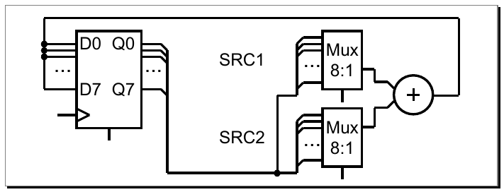
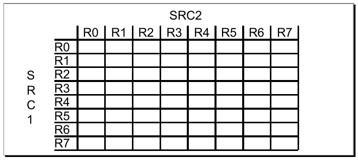
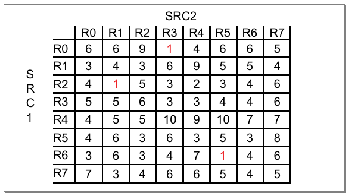

.. _UTILITY/CoveragePkg:

Functional Coverage Using CoveragePkg
#####################################

.. _UTILITY/CoveragePkg/Overview:

Overview
********

The VHDL package, :vhdlcode:`CoveragePkg`, provides subprograms that facilitate implementation of functional coverage
within VHDL. It is a core part of the Open Source VHDL Verification Methodology (OSVVM). While :vhdlcode:`CoveragePkg`
is just a package, it offers a similar conciseness to the language syntax of other verification languages, such as
SystemVerilog or 'e'. In addition, it offers capability and flexibility that is a step ahead.

Functional coverage is code we write to track execution of a test plan. It is important to any verification approach
since it is one of the factors in determining when testing is done. I will address this more in the section, ":ref:`What
is Functional Coverage and why do I need it? <UTILITY/CoveragePkg/WhatIsFunctionalCoverageAndWhyDoINeedIt>`" In this
section I will also address, ":ref:`Why can't I just use code coverage?
<UTILITY/CoveragePkg/WhyCanTIJustUseCodeCoverage>`" and ":ref:`Why you need functional coverage, even with directed
testing <UTILITY/CoveragePkg/WhyYouNeedFunctionalCoverageEvenWithDirectedTesting>`."

Writing functional coverage is concise and flexible. The basics of writing functional coverage using coverage package
are covered in the section, ":ref:`Writing Functional Coverage using CoveragePkg
<UTILITY/CoveragePkg/WritingFunctionalCoverageUsingCoveragePkg>`."

One important, unique feature is the "Intelligent Coverage" that is built directly into the coverage data structure.
This capability allows us to randomly select a hole in the current functional coverage to pass to the stimulus
generation process. Using "Intelligent Coverage" helps minimize the number of test cases generated to achieve complete
coverage - resulting in fewer simulation cycles and a higher velocity of verification. More details are provided in the
section, ":ref:`Intelligent Coverage is 5X or more faster than constrained random testing
<UTILITY/CoveragePkg/IntelligentCoverageIs5XOrMoreFasterThanConstrainedRandom>`."

Functional coverage with :vhdlcode:`CoveragePkg` is captured incrementally using sequential code. This provides a great
deal of flexibility and capability, and facilitates writing high fidelity functional coverage models. More details are
provided in the section, ":ref:`Flexibility and Capability <UTILITY/CoveragePkg/FlexibilityAndCapability>`."

:vhdlcode:`CoveragePkg` provides an API that provides a powerful capability. This API is documented in the remaining
part of the document.

Caution, the package also contains additional undocumented subprograms that are either experimental features or
artifacts from older use models. Use these at your own risk as they may be removed from future revisions.

This documentation is not a substitute for a great training class. :vhdlcode:`CoveragePkg` was developed and is
maintained by Jim Lewis of SynthWorks. It evolved from methodology and packages developed for SynthWorks' Advanced VHDL
Testbenches and Verification class. Please support our effort in supporting OSVVM by purchasing your VHDL training from
SynthWorks.

All :vhdlcode:`CoveragePkg` uses protected types (VHDL-2002) and :vhdlcode:`integer_vector` (VHDL-2008). As a result,
most simulators should be able to support it.

Please note while the packages are Apache open source, this document’s copyright is similar to the creative commons
license CC BY-ND 4.0. You may use and distribute exact copies of this document. However, without written permission, the
copyright does not permit you to use these materials (in particular examples) to develop your own training – let's be
fair we have to earn a living.

.. _UTILITY/CoveragePkg/GettingCoveragePkg:

Getting CoveragePkg
*******************

:vhdlcode:`CoveragePkg` is released under the Apache open source license. It is free (both to download and use - there
are no license fees). You can download it from https://github.com/OSVVM/OSVVM. It will be updated from time to time.
Currently there are numerous planned revisions.

If you add features to the package, please donate them back under the same license and do a pull request. If you need
features, be sure to contact us. I blog about the packages at http://www.synthworks.com/blog. We also support a user
community and blogs through http://www.osvvm.org.

This package requires VHDL-2008.

.. _UTILITY/CoveragePkg/WhatIsFunctionalCoverageAndWhyDoINeedIt:

What is Functional Coverage and why do I need it?
*************************************************

.. _UTILITY/CoveragePkg/WhatIsFunctionalCoverage:

What is Functional Coverage?
============================

Functional coverage is code that observes execution of a test plan. As such, it is code you write to track whether
important values, sets of values, or sequences of values that correspond to design or interface requirements, features,
or boundary conditions have been exercised.

Functional coverage is important to any verification approach since it is one of the factors used to determine when
testing is done. Specifically, 100% functional coverage indicates that all items in the test plan have been tested.
Combine this with 100% code coverage and it indicates that testing is done.

Functional coverage that examines the values within a single object is called either point (SystemVerilog) or item ('e')
coverage. I prefer the term item coverage since point can also be a single value within a particular bin. One
relationship we might look at is different transfer sizes across a packet based bus. For example, the test plan may
require that transfer sizes with the following size or range of sizes be observed: 1, 2, 3, 4 to 127, 128 to 252, 253,
254, or 255.

Functional coverage that examines the relationships between different objects is called cross coverage. An example of
this would be examining whether an ALU has done all of its supported operations with every different input pair of
registers.

Many think functional coverage is an exclusive capability of a verification language such as SystemVerilog. However,
functional coverage collection is really just a matter of implementing a data structure.

:vhdlcode:`CoveragePkg` contains an API that facilitates creating the functional coverage data structure and writing
functional coverage.

.. _UTILITY/CoveragePkg/WhyCanTIJustUseCodeCoverage:

Why can't I just use code coverage?
===================================

VHDL simulation tools can automatically calculate a metric called code coverage (assuming you have licenses for this
feature). Code coverage tracks what lines of code or expressions in the code have been exercised.

Code coverage cannot detect conditions that are not in the code. For example, in the packet bus item coverage example
discussed above, code coverage cannot determine that the required values or ranges have occurred - unless the code
contains expressions to test for each of these sizes. Instead, we need to write functional coverage.

In the ALU cross coverage example above, code coverage cannot determine whether particular register pairs have been used
together, unless the code is written this way. Generally each input to the ALU is selected independently of the other.
Again, we need to write functional coverage.

Code coverage on a partially implemented design can reach 100%. It cannot detect missing features (oops forgot to
implement one of the timers) and many boundary conditions (in particular those that span more than one block). Hence,
code coverage cannot be used exclusively to indicate we are done testing.

In addition, code coverage is an optimistic metric. In combinational logic code in an HDL, a process may be executed
many times during a given clock cycle due to delta cycle changes on input signals. This can result in several different
branches of code being executed. However, only the last branch of code executed before the clock edge truly has been
covered.

.. _UTILITY/CoveragePkg/TestDoneTestPlanExecutedAndAllCodeExecuted:

Test Done = Test Plan Executed and All Code Executed
====================================================

To know testing is done, we need to know that both the test plan is executed and all of the code has been executed. Is
100% functional coverage enough?

Unfortunately, a test can reach 100% functional coverage without reaching 100% code coverage. This indicates the design
contains untested code that is not part of the test plan. This can come from an incomplete test plan, extra undocumented
features in the design, or case statement others branches that do not get exercised in normal hardware operation.
Untested features need to either be tested or removed.

As a result, even with functional coverage it is still a good idea to use code coverage as a fail-safe for the test
plan.

.. _UTILITY/CoveragePkg/WhyYouNeedFunctionalCoverageEvenWithDirectedTesting:

Why You Need Functional Coverage, even with Directed Testing
============================================================

You might think, "I have written a directed test for each item in the test plan, I am done right?"

As design size grows, the complexity increases. A test that completely validates one version of the design, may not
validate the design after revisions. For example, if the size of a FIFO increases, the test may no longer provide enough
stimulus values to fill it completely and cause a FIFO Full condition. If new features are added, a test may need to
change its configuration register values to enable the appropriate mode.

Without functional coverage, you are assuming your directed, algorithmic, file based, or constrained random test
actually hits the conditions in your test plan.

Don't forget the engineers creed, "In the divine we trust, all others need to show supporting data." Whether you are
using directed, algorithmic, file based, or constrained random test methods, functional coverage provides your
supporting data.

.. _UTILITY/CoveragePkg/WhatIsCoverageThen:

What is "Coverage" then?
========================

The word coverage can refer to functional coverage, code coverage, or property coverage (such as with PSL). Since this
document focuses on functional coverage, when the word coverage is used by itself, it is functional coverage.

.. _UTILITY/CoveragePkg/WritingFunctionalCoverageUsingCoveragePkg:

Writing Functional Coverage Using CoveragePkg
*********************************************

Functional coverage can be written using any code. :vhdlcode:`CoveragePkg` and language syntax are solely intended to
simplify this effort. In this section, we will first look at implementing functional coverage manually (without
:vhdlcode:`CoveragePkg`). Then we will look at using :vhdlcode:`CoveragePkg` to capture item and cross coverage.

.. _UTILITY/CoveragePkg/ItemPointCoverageDoneManually:

Item (Point) Coverage done Manually
***********************************

In this subsection we write item coverage using regular VHDL code. While for most problems this is the hard way to
capture coverage, it provides a basis for understanding functional coverage.

In a packet based transfer (such as across an ethernet port), most interesting things happen when the transfer size is
at or near either the minimum or maximum sized transfers. It is important that a number of medium sized transfers occur,
but we do not need to see as many of them. For this example, let's assume that we are interested in tracking transfers
that are either the following size or range: 1, 2, 3, 4 to 127, 128 to 252, 253, 254, or 255. The sizes we look for are
specified by our test plan.

We also must decide when to capture (aka sample) the coverage. In the following code, we use the rising edge of clock
where the flag :vhdlcode:`TransactionDone` is 1.

.. code-block:: VHDL

   signal Bin : integer_vector(1 to 8) ;
   . . .
   process
   begin
     wait until rising_edge(Clk) and TransactionDone = '1' ;
     case to_integer(unsigned(ActualData)) is
       when   1 =>          Bin(1) <= Bin(1) + 1 ;
       when   2 =>          Bin(2) <= Bin(2) + 1 ;
       when   3 =>          Bin(3) <= Bin(3) + 1 ;
       when   4 to 127 =>   Bin(4) <= Bin(4) + 1 ;
       when 128 to 252 =>   Bin(5) <= Bin(5) + 1 ;
       when 253 =>          Bin(6) <= Bin(6) + 1 ;
       when 254 =>          Bin(7) <= Bin(7) + 1 ;
       when 255 =>          Bin(8) <= Bin(8) + 1 ;
       when others =>
     end case ;
   end process ;

Any coverage can be written this way. However, this is too much work and too specific to the problem at hand. We could
make a small improvement to this by capturing the code in a procedure. This would help with local reuse, but there are
still no built-in operations to determine when testing is done, to print reports, or to save results and the data
structure to a file.

.. _UTILITY/CoveragePkg/BasicItemPointCoverageWithCoveragePkg:

Basic Item (Point) Coverage with CoveragePkg
********************************************

In this section we use :vhdlcode:`CoveragePkg` to write the item coverage for the same packet based transfer sizes
created in the previous section manually. Again, we are most interested in the smallest and largest transfers. Hence,
for an interface that can transfer between 1 and 255 words we will track transfers of the following size or range: 1, 2,
3, 4 to 127, 128 to 252, 253, 254, and 255.

The basic steps to model functional coverage are

* Reference Packages
* Declare a Coverage ID
* Construct the Coverage Model
* Model Coverage
* Accumulate coverage
* Detecting when Done
* Print Results

.. _UTILITY/CoveragePkg/ReferencePackages:

Reference Packages
==================

The simplest way to include OSVVM utility library in your tests is reference the OSVVM context declaration.

.. code-block:: VHDL

   library OSVVM ;
     context osvvm.OsvvmContext ;

.. _UTILITY/CoveragePkg/DeclareACoverageID:

Declare a Coverage ID
=====================

A Coverage ID is a handle to the coverage object that is created internal to :vhdlcode:`CoveragePkg`. A Coverage ID has
the type :vhdlcode:`CoverageIDType`. :vhdlcode:`CoverageIDType` is a regular type and can be held in a signal or
variable.

.. code-block:: VHDL

   architecture Test1 of tb is
     signal Cov1 : CoverageIDType ;
   begin

.. _UTILITY/CoveragePkg/ConstructTheCoverageModel:

Construct the Coverage Model
============================

:vhdlcode:`NewID` allocates the initial coverage data structure. The data structure must be initialized before any other
coverage API operation is used.

.. code-block:: VHDL

   Cov1 <= NewID("Cov1") ;
   wait for 0 ns ; -- Update Cov1

.. _UTILITY/CoveragePkg/ModelCoverageItemCoverage:

Model Coverage: Item Coverage
=============================

Internal to the data structure, each bin in an item coverage model is represented by a minimum and maximum value
(effectively a range). Bins that have only a single value, such as 1 are represented by the pair 1, 1 (meaning 1 to 1).
Internally, the minimum and maximum values are stored in a record with other bin information.

The coverage items are added to the coverage model by using the procedure :vhdlcode:`AddBins` and the function
:vhdlcode:`GenBin`. :vhdlcode:`GenBin` transforms a bin descriptor into a set of bins. :vhdlcode:`AddBins` inserts these
bins into the coverage data structure. The version of :vhdlcode:`GenBin` shown below has three parameters: min value,
max value, and number of bins. The call, :vhdlcode:`GenBin(1,3,3)`, breaks the range 1 to 3 into the 3 separate bins
with ranges 1 to 1, 2 to 2, 3 to 3.

.. code-block:: VHDL

   TestProc : process
   begin
     --                    min, max, #bins
     AddBins(Cov1, GenBin(1,   3,   3)); -- bins 1 to 1, 2 to 2, 3 to 3
     . . .

Additional calls to :vhdlcode:`AddBins` appends bins to the data structure. As a result, the call,
:vhdlcode:`GenBin(4, 252, 2)`, appends two bins with the ranges 4 to 127 and 128 to 252 respectively to the coverage
model.

.. code-block:: VHDL

   AddBins(Cov1, GenBin(  4, 252, 2)) ; -- bins 4 to 127 and 128 to 252

Since creating one bin for each value within a range is common, there is also a version of :vhdlcode:`GenBin` that has
two parameters: min value and max value which creates one bin per value. As a result, the call
:vhdlcode:`GenBin(253, 255)` appends three bins with the ranges 253 to 253, 254 to 254, and 255 to 255.

.. code-block:: VHDL

   AddBins(Cov1, GenBin(253, 255)) ; -- bins 253, 254, 255

.. _UTILITY/CoveragePkg/AccumulateCoverageItemCoverage:

Accumulate Coverage: Item Coverage
==================================

Coverage is accumulated using the :vhdlcode:`ICover`. Since coverage is collected using sequential code, either clock
based sampling (shown below) or transaction based sampling (by calling :vhdlcode:`ICover` after a transaction completes
- shown in later examples) can be used.

.. code-block:: VHDL

   -- Accumulating coverage using clock based sampling
   loop
     wait until rising_edge(Clk) and nReset = '1' ;
     ICover(Cov1, to_integer(RxData_slv)) ;
   end loop ;

.. _UTILITY/CoveragePkg/DetectingWhenDone:

Detecting when Done
===================

A test is done when functional coverage reaches 100%. :vhdlcode:`IsCovered` returns true when all the count bins in the
coverage data structure have reached their goal. The following code shows the previous loop modified so that it exits
when coverage reaches 100%.

.. code-block:: VHDL

   -- capture coverage until coverage is 100%
   loop
       wait until rising_edge(Clk) and nReset = '1' ;
       ICover(Cov1, to_integer(RxData_slv)) ;
       exit when IsCovered(Cov1) ;
   end loop ;

.. _UTILITY/CoveragePkg/PrintResults:

Print Results
=============

Finally, when the test is done, :vhdlcode:`WriteBin` is used to print the coverage results to the file specified by
:vhdlcode:`TranscriptPkg` (either :vhdlcode:`TranscriptFile`, :vhdlcode:`OUTPUT`, or both if mirroring is enabled).

.. code-block:: VHDL

   WriteBin(Cov1) ;

.. _UTILITY/CoveragePkg/ItemCoverageCompleteExample:

Item Coverage, Complete Example
===============================

Putting the entire example together, we end up with the following.

.. code-block:: VHDL

   architecture Test1 of tb is
     signal Cov1 : CoverageIDType ;  -- Coverage ID
   begin
     TestProc : process
     begin
       -- Construct the coverage model
       Cov1 <= NewID("Cov1") ;
       wait for 0 ns ; -- Update Cov1

       -- Model the coverage
       AddBins(Cov1, GenBin(  1,   3     )) ;
       AddBins(Cov1, GenBin(  4, 252, 2)) ;
       AddBins(Cov1, GenBin(253, 255   )) ;

       -- Accumulating Coverage
       -- clock based sampling
       loop
         wait until rising_edge(Clk) and nReset = '1' ;
         ICover(Cov1, to_integer(RxData_slv)) ;
         exit when IsCovered(Cov1) ;
       end loop ;

       -- Print Results
       WriteBin(Cov1) ;
       wait ;
     end process ;

Note that when modeling coverage, we primarily work with integer values. All of the inputs to :vhdlcode:`GenBin` and
:vhdlcode:`ICover` are integers; :vhdlcode:`WriteBin` reports results in terms of integers. This is similar to what
other verification languages do.

.. _UTILITY/CoveragePkg/CrossCoverageWithCoveragePkg:

Cross Coverage with CoveragePkg
*******************************

Cross coverage examines the relationships between different objects, such as making sure that each register source has
been used with an ALU. The hardware we are working with is as shown below. Note that the test plan will also be
concerned about what values are applied to the adder. We are not intending to address that part of the test here.

Cross coverage for SRC1 crossed SRC2 can be visualized as a matrix of 8 x 8 bins.

The steps for modeling cross coverage are the same steps used for item coverage: declare, construct, model, accumulate,
detect done, and report. Collecting cross coverage only differs in the model and accumulate steps.

.. _UTILITY/CoveragePkg/ModelCoverageCrossCoverage:

Model Coverage: Cross Coverage
==============================

Cross coverage is modeled using :vhdlcode:`AddCross` and two or more calls to function :vhdlcode:`GenBin`.
:vhdlcode:`AddCross` creates the cross product of the set of bins (created by :vhdlcode:`GenBin`) on its inputs. The
code below shows the call to create the 8 x 8 cross. Each call to :vhdlcode:`GenBin(0,7)` creates the 8 bins: 0, 1, 2,
3, 4, 5, 6, 7. The :vhdlcode:`AddCross` creates the 64 bins cross product of these bins. This can be visualized as the
matrix shown previously.

.. code-block:: VHDL

   AddCross(ACov, GenBin(0,7), GenBin(0,7) );

:vhdlcode:`AddCross` supports crossing of up to 20 items. Internal to the data structure there is a record that holds
minimum and maximum values for each item in the cross. Hence for the first bin, the record contains SRC1 minimum 0, SRC1
maximum 0, SRC2 minimum 0, and SRC2 maximum 0. The record also contains other bin information (such as coverage goal,
current count, bin type (count, illegal, ignore), and weight).

.. _UTILITY/CoveragePkg/AccumualteCoverageCrossCoverage:

Accumulate Coverage: Cross Coverage
===================================

The accumulate step now requires a value for SRC1 and SRC2. The overloaded :vhdlcode:`ICover` for cross coverage uses an
:vhdlcode:`integer_vector` input. This allows it to accept a value for each item in the cross. The extra set of
parentheses around :vhdlcode:`Src1` and :vhdlcode:`Src2` in the call to :vhdlcode:`ICover` below designate that it is a
:vhdlcode:`integer_vector`.

.. code-block:: VHDL

   ICover(ACov, (Src1, Src2) ) ;

.. _UTILITY/CoveragePkg/CrossCoverageComplete:

Cross Coverage, Complete
========================

The code below shows the entire example. The signal, :vhdlcode:`ACov`, declares the coverage ID. :vhdlcode:`NewID`
constructs the coverage model. :vhdlcode:`AddCross` adds cross coverage items to the coverage model. Each register is
selected using uniform randomization (:vhdlcode:`RandInt`). The transaction procedure, :vhdlcode:`DoAluOp`, applies the
stimulus. :vhdlcode:`ICover` accumulates the coverage. :vhdlcode:`IsCovered` determines when all items in the coverage
model have been covered. :vhdlcode:`WriteBin` reports the coverage.

.. code-block:: VHDL

   architecture Test2 of tb is
     signal ACov : CoverageIDType ;  -- Declare ID
   begin
     TestProc : process
       variable RV : RandomPType ;
       variable Src1, Src2 : integer ;
     begin
       -- create coverage model
       AddCross(ACov, GenBin(0,7), GenBin(0,7) );  -- Model

       loop
         Src1 := RV.RandInt(0, 7) ;     -- Uniform Randomization
         Src2 := RV.RandInt(0, 7) ;

         DoAluOp(TRec, Src1, Src2) ;    -- Transaction
         ICover(ACov, (Src1, Src2) ) ;  -- Accumulate
         exit when IsCovered(ACov) ;    -- Done?
       end loop ;

       WriteBin(ACov) ;  -- Report
       ReportAlerts ;
     end process ;

.. _UTILITY/CoveragePkg/IntelligentCoverageIs5XOrMoreFasterThanConstrainedRandom:

Intelligent Coverage is 5X or more faster than constrained random
*****************************************************************

.. _UTILITY/CoveragePkg/ConstrainedRandomRepeatsTestCases:

Constrained Random Repeats Test Cases
=====================================

In the previous section we used uniform randomization (shown below) to select the register pairs for the ALU.
Constrained random at its best produces a uniform distribution. As a result, the previous example is a best case model
of constrained random tests – whether it is VHDL or other (SystemVerilog, e, …).

.. code-block:: VHDL

   Src1 := RV.RandInt(0, 7) ;     -- Uniform Randomization
   Src2 := RV.RandInt(0, 7) ;

The problem with constrained random testbenches is that they repeat some test cases before generating all test cases. In
general to generate N cases, it takes "N \* log N" randomizations. The "log N" represents repeated test cases and
significantly adds to simulation run times. Ideally we would like to run only N test cases.

Running the previous ALU testbench, we get the following coverage matrix when the code completes. Note that some test
cases were generated 10 times before all were done at least 1 time. It took 315 randomizations to generate all 64 unique
pairs. This is slightly less than 5X more iterations than the 64 in the ideal case. This correlates well with theory as
315 ≈ 64 \* log(64). By changing the seed value, the exact number of randomizations may increase or decrease but this
would be a silly way to try to reduce the number of iterations a test runs.

.. _UTILITY/CoveragePkg/IntelligentCoverage:

Intelligent Coverage
====================

"Intelligent Coverage" is a coverage driven randomization approach that randomly selects a hole in the functional
coverage and passes it to the stimulus generation process. Using "Intelligent Coverage" allows the stimulus generation
to focus on missing coverage and reduces the number of test cases generated to approach the ideal of N randomizations to
generate N test cases.

Let's return to the ALU example. The Intelligent Coverage methodology starts by writing functional coverage. We did this
in the previous example too. Next preliminary stimulus is generated by randomizing using the functional coverage model.
In this example, we will replace the uniform randomization with :vhdlcode:`RandInt` with a call to
:vhdlcode:`GetRandPoint` (one of the Intelligent Coverage randomization functions). This is shown below. In this case,
:vhdlcode:`Src1` and :vhdlcode:`Src2` are used directly in the test, so we are done.

.. code-block:: VHDL

   architecture Test3 of tb is
     signal ACov : CoverageIDType ;  -- Declare ID
   begin
     TestProc : process
       variable RV : RandomPType ;
       variable Src1, Src2 : integer ;
     begin
       -- create coverage model
       AddCross(ACov, GenBin(0,7), GenBin(0,7) );  -- Model

       loop
         (Src1, Src2) := GetRandPoint(ACov) ; -- Intelligent Coverage Randomization

         DoAluOp(TRec, Src1, Src2) ;    -- Transaction
         ICover(ACov, (Src1, Src2) ) ;  -- Accumulate
         exit when IsCovered(ACov) ;    -- Done?
       end loop ;

       WriteBin(ACov) ;  -- Report
       ReportAlerts ;
     end process ;

When randomizing across a cross coverage model, the output of :vhdlcode:`GetRandPoint` is an :vhdlcode:`integer_vector`.
Instead of using the separate integers, :vhdlcode:`Src1` and :vhdlcode:`Src2`, it is also possible to use an
:vhdlcode:`integer_vector` as shown below.

.. code-block:: VHDL

   variable Src : integer_vector(1 to 2) ;
   . . .
   Src := GetRandPoint(ACov) ;      -- Intelligent Coverage Randomization

The process is not always this easy. Sometimes the value out of :vhdlcode:`GetRandPoint` will need to be further shaped
by the stimulus generation process. This is particularly true when randomizing an output value of a design and
generating the desired input sequence to generate it.

The Intelligent Coverage methodology works with your current testbench approach. You can adopt this methodology
incrementally. Add functional coverage today to make sure you are executing all of your test plan. For the tests that
need help, use the Intelligent Coverage.

.. _UTILITY/CoveragePkg/IntelligentCoverageReducesYourWork:

Intelligent Coverage reduces your work
======================================

The Intelligent Coverage methodology is different from what is done in a constrained random methodology. Rather than
randomizing across holes in the functional coverage, the constrained random approach adds an equally complex set of
randomization constraints to shape the stimulus. In many ways, the randomization constraints and functional coverage
needed in a constrained random approach are duplicate views of the same information.

With Intelligent coverage, we focus on writing high fidelity coverage models. The constrained random step is reduced to
a refinement step and only needs to focus on things that are not already shaped by the coverage. Hence, Intelligent
Coverage methodology reduces (or eliminates) the work needed to generate test constraints.

.. _UTILITY/CoveragePkg/FlexibilityAndCapability:

Flexibility and Capability
**************************

OSVVM implements functional coverage as a data structure within a protected type. The protected type is hidden from view
by a singleton that is accessed via the coverage API. Using subprograms of the coverage API allows both a concise
capture of the model (as we saw in the previous examples) and a great degree of flexibility and capability.

The added flexibility and capability comes from writing the model incrementally using any sequential code (if, loop). As
long as the entire model is captured before we start collecting coverage, we can use as many calls to
:vhdlcode:`AddBins` or :vhdlcode:`AddCross` as needed. As a result, conditionally capturing coverage based on a generic
is straight forward. In addition, algorithms that iterate using a loop are no more trouble than writing the code.

Additional flexibility and capability come from being able to give each bin within a coverage model a different coverage
goal. A coverage goal specifies the number of times a value from a particular bin needs to be observed before it is
considered covered. The Intelligent Coverage randomization by default will use these coverage goals as randomization
weights.

To demonstrate this flexibility, let's consider a contrived example based on the ALU. In this example, each SRC1 crossed
with any SRC2 has a different coverage goal. In addition, it is illegal for SRC1 to equal SRC2. The coverage goal for
each bin is specified in the table below.

.. list-table::
   :header-rows: 1
   :widths: 195 216 216

   * - Coverage Goal
     - Src1
     - Src2
   * - 2
     - 0
     - 1, 2, 3, 4, 5, 6, 7
   * - 3
     - 1
     - 0, 2, 3, 4, 5, 6, 7
   * - 4
     - 2
     - 0, 1, 3, 4, 5, 6, 7
   * - 5
     - 3
     - 0, 1, 2, 4, 5, 6, 7
   * - 5
     - 4
     - 0, 1, 2, 3, 5, 6, 7
   * - 4
     - 5
     - 0, 1, 2, 3, 4, 6, 7
   * - 3
     - 6
     - 0, 1, 2, 3, 4, 5, 7
   * - 2
     - 7
     - 0, 1, 2, 3, 4, 5, 6
   * - Illegal
     - :vhdlcode:`Src1 = Src2`
     -

To model the above functional coverage, we use a separate call for each different coverage goal. The function,
:vhdlcode:`IllegalBin`, is used to mark the bins with :vhdlcode:`Src1 = Src2` illegal. This is shown below.

.. code-block:: VHDL

   architecture Test4 of tb is
     signal ACov : CoverageIDType ;                -- Declare Cov Object
   begin
     TestProc : process
       variable Src1, Src2 : integer ;
     begin
       ACov <= NewID("ACov") ;
       wait for 0 ns ; -- let ACov update

       -- Capture coverage model
       AddCross(ACov,  2,  GenBin (0),  IllegalBin(0) & GenBin(1,7)) ;
       AddCross(ACov,  3,  GenBin (1),  GenBin(0)   & IllegalBin(1) & GenBin(2,7)) ;
       AddCross(ACov,  4,  GenBin (2),  GenBin(0,1) & IllegalBin(2) & GenBin(3,7)) ;
       AddCross(ACov,  5,  GenBin (3),  GenBin(0,2) & IllegalBin(3) & GenBin(4,7)) ;
       AddCross(ACov,  5,  GenBin (4),  GenBin(0,3) & IllegalBin(4) & GenBin(5,7)) ;
       AddCross(ACov,  4,  GenBin (5),  GenBin(0,4) & IllegalBin(5) & GenBin(6,7)) ;
       AddCross(ACov,  3,  GenBin (6),  GenBin(0,5) & IllegalBin(6) & GenBin(7)) ;
       AddCross(ACov,  2,  GenBin (7),  GenBin(0,6) & IllegalBin(7) ) ;

       loop              -- Done?
         (Src1, Src2) := GetRandPoint(ACov) ;      -- Randomize with coverage

         DoAluOp(TRec, Src1, Src2) ;              -- Do a transaction
         ICover(ACov, (Src1, Src2) ) ;            -- Accumulate
         exit when IsCovered(ACov) ;              -- Done?
       end loop ;

       WriteBin(ACov) ;                            -- Report
       ReportAlerts ;
     end process ;

Note that the remainder of this document covers further details of the coverage API.

.. _UTILITY/CoveragePkg/CoverageAPIReference:

Coverage API Reference
**********************

The intent of the API is to make the creation of coverage models easy. It is interesting to note that using the Coverage
API is as concise as the language features of SystemVerilog. Going beyond that OSVVM has coverage introspection
capability, such as intelligent coverage randomization, that is not available in SystemVerilog.

Behind the simple API are some rather interesting data structures. The important thing to note is that you do not need
to understand the data structures to be able to use :vhdlcode:`CoveragePkg`.

Caution, features not documented here are either considered experimental or have been deprecated (and may be removed in
a future version). If you decide to use it and want it to stay around, be sure to let us know.

.. _UTILITY/CoveragePkg/ConstructingTheCoverageModel:

Constructing the Coverage Model
*******************************

.. _UTILITY/CoveragePkg/NewIDAndSupportingTypes:

NewID and Supporting Types
==========================

.. _UTILITY/CoveragePkg/NewIDDataStructureConstructor:

NewID: Data Structure Constructor
---------------------------------

:vhdlcode:`NewID` allocates and initializes the coverage data structure that is used for tracking coverage. It must be
called before any other coverage operations are used.

.. code-block:: VHDL

   impure function NewID (
     Name                : String ;
     ParentID            : AlertLogIDType          := OSVVM_COVERAGE_ALERTLOG_ID ;
     ReportMode          : AlertLogReportModeType  := ENABLED ;
     Search              : NameSearchType          := PRIVATE_NAME ;
     PrintParent         : AlertLogPrintParentType := PRINT_NAME_AND_PARENT
   ) return CoverageIDType ;

:vhdlcode:`NewID` also creates an :vhdlcode:`AlertLogID` for the data structure using the value of the name parameter
and initializes the randomization seed that is part of the coverage model (see
:ref:`InitSeed <UTILITY/CoveragePkg/InitSeedSetsTheRandomizationSeed>`). The :vhdlcode:`AlertLogID` is used to signal an
error when an item is put in an illegal bin.

.. _UTILITY/CoveragePkg/NewReqIDDataStructureConstructor:

NewReqID: Data Structure Constructor
------------------------------------

:vhdlcode:`NewReqID` allocates and initializes the coverage data structure that is used for tracking coverage as a
requirement. It must be called before any other coverage operations are used.

.. code-block:: VHDL

   impure function NewReqID (
     Name                : String ;
     ParentID            : AlertLogIDType          := OSVVM_COVERAGE_ALERTLOG_ID ;
     ReportMode          : AlertLogReportModeType  := ENABLED ;
     Search              : NameSearchType          := PRIVATE_NAME ;
     PrintParent         : AlertLogPrintParentType := PRINT_NAME_AND_PARENT
   ) return CoverageIDType ;

:vhdlcode:`NewReqID` also creates an :vhdlcode:`AlertLogID` for the data structure using the value of the name parameter
and initializes the randomization seed that is part of the coverage model (see
:ref:`InitSeed <UTILITY/CoveragePkg/InitSeedSetsTheRandomizationSeed>`). The :vhdlcode:`AlertLogID` is used for error
signaling and tracking requirements. An error is signaled when an item is put in an illegal bin. The requirements goal
is the sum of the number of coverage bins. The requirements count is the sum of the number of coverage bins with passing
coverage goals.

.. _UTILITY/CoveragePkg/CoverageIDType:

CoverageIDType
--------------

:vhdlcode:`CoverageIDType` is defined as follows.

.. code-block:: VHDL

   type CoverageIDType is record
     ID : integer_max ;
   end record CoverageIDType;

.. _UTILITY/CoveragePkg/AlertLogReportModeType:

AlertLogReportModeType
----------------------

.. code-block:: VHDL

   type AlertLogReportModeType is (DISABLED, ENABLED, NONZERO) ;

When :vhdlcode:`DISABLED`, an :vhdlcode:`AlertLogID` does not print in :vhdlcode:`ReportAlerts` (text reports) or
:vhdlcode:`WriteAlertYaml` (Yaml/HTML reports). When :vhdlcode:`NONZERO`, an :vhdlcode:`AlertLogID` does not print in
:vhdlcode:`ReportAlerts`, but prints in :vhdlcode:`WriteAlertYaml`. Hence, :vhdlcode:`NONZERO` shortens the text reports
to what is essential. When :vhdlcode:`ENABLED`, an :vhdlcode:`AlertLogID` prints in :vhdlcode:`ReportAlerts` and
:vhdlcode:`WriteAlertYaml`.

None of these settings impact printing in Alert or Log.

:vhdlcode:`DISABLED` is intended to be used for data structures that are not used for self-checking and may produce
errors on parameter checks. These errors are not lost as they are still accumulated in the parent ID.

.. _UTILITY/CoveragePkg/AlertLogPrintParentType:

AlertLogPrintParentType
-----------------------

.. code-block:: VHDL

   type AlertLogPrintParentType is (PRINT_NAME, PRINT_NAME_AND_PARENT) ;

When :vhdlcode:`PRINT_NAME`, Alert and Log print the name of the :vhdlcode:`AlertLogID`. When
:vhdlcode:`PRINT_NAME_AND_PARENT`, Alert and Log print the parent ID name, the ID separator, and then the ID name.

.. _UTILITY/CoveragePkg/NameSearchType:

NameSearchType
--------------

.. code-block:: VHDL

   type NameSearchType is (
       PRIVATE_NAME, NAME, NAME_AND_PARENT, NAME_AND_PARENT_ELSE_PRIVATE) ;

When :vhdlcode:`NewID` is called, first a search of existing IDs is done. If there is a match, that ID is returned, if
there is not, a new one is created. Matching is determined by the ID, :vhdlcode:`ParentID`, and :vhdlcode:`Search`
parameters. If the :vhdlcode:`Search` parameter is :vhdlcode:`PRIVATE_NAME`, no searching is done and a new ID is
created. If the :vhdlcode:`Search` parameter is :vhdlcode:`NAME`, then any ID whose name matches is returned. If the
:vhdlcode:`Search` parameter is :vhdlcode:`NAME_AND_PARENT`, then any ID whose name and :vhdlcode:`ParentID` match or
:vhdlcode:`NAME` and stored :vhdlcode:`Search` parameter is :vhdlcode:`NAME` is returned.

.. _UTILITY/CoveragePkg/BasicBinDescriptionGenBinIllegalBinAndIgnoreBin:

Basic Bin Description: GenBin, IllegalBin, and IgnoreBin
********************************************************

The functions :vhdlcode:`GenBin`, :vhdlcode:`IllegalBin`, and :vhdlcode:`IgnoreBin` are used to create bins of type
:vhdlcode:`CovBinType`. These bins are used as inputs to :vhdlcode:`AddBins` and :vhdlcode:`AddCross` to create the
coverage model. Using these functions replaces the need to know the details of type :vhdlcode:`CovBinType`.

.. _UTILITY/CoveragePkg/BasicTypeForCoverageBins:

Basic Type for Coverage Bins
============================

The output type of the functions :vhdlcode:`GenBin`, :vhdlcode:`IllegalBin`, and :vhdlcode:`IgnoreBin` is
:vhdlcode:`CovBinType`. It is declared as an array of the record type, :vhdlcode:`CovBinBaseType`. This is shown below.
Note the details of :vhdlcode:`CovBinBaseType` are not provided as they may change from time to time.

.. code-block:: VHDL

   type CovBinBaseType is record
     . . .
   end record ;
   type CovBinType is array (natural range <>) of CovBinBaseType ;

.. _UTILITY/CoveragePkg/CreatingCountBinsGenBin:

Creating Count Bins - GenBin
============================

The following are three variations of :vhdlcode:`GenBin`. The ones with :vhdlcode:`AtLeast` and :vhdlcode:`Weight`
parameters are mainly intended for use with constants.

.. code-block:: VHDL

   function GenBin(Min, Max, NumBin : integer ) return CovBinType ;
   function GenBin(Min, Max : integer) return CovBinType ;
   function GenBin(A : integer) return CovBinType ;

The version of :vhdlcode:`GenBin` shown below has three parameters: min value, max value, and number of bins. The call,
:vhdlcode:`GenBin(1, 3, 3)`, breaks the range 1 to 3 into the 3 separate bins with ranges 1 to 1, 2 to 2, 3 to 3.

.. code-block:: VHDL

   --                    min, max, #bins
   AddBins(CovBin1, GenBin(1,   3,   3)); -- bins 1 to 1, 2 to 2, 3 to 3

If there are less values (between max and min) than bins, then only "max - min + 1" bins will be created. As a result,
the call :vhdlcode:`GenBin(1,3,20)`, will still create the three bins: 1 to 1, 2 to 2 and 3 to 3.

.. code-block:: VHDL

   AddBins(CovBin2, GenBin(1, 3, 20) ) ; -- bins 1 to 1, 2 to 2, and 3 to 3

If there are more values (between max and min) than bins and the range does not divide evenly among bins, then each bin
will have on average (max - min + 1)/bins. Later bins will have one more value than earlier bins. The exact formula used
is (number of values remaining)/(number of bins remaining). As a result, the call :vhdlcode:`GenBin(1, 14, 4)` creates
four bins with ranges 1 to 3, 4 to 6, 7 to 10, and 11 to 14.

.. code-block:: VHDL

   AddBins(CovBin2,  GenBin(1, 14, 4) ) ; -- 1 to 3, 4 to 6, 7 to 10, 11 to 14

Since creating one bin per value in the range is common, there is also a version of :vhdlcode:`GenBin` that has two
parameters: min value and max value which creates one bin per value. As a result, the first call to
:vhdlcode:`AddBins`/:vhdlcode:`GenBin` can be shortened to the following.

.. code-block:: VHDL

   --                    min, max
   AddBins(CovBin1, GenBin(1,   3));  -- bins 1 to 1, 2 to 2, and 3 to 3

:vhdlcode:`GenBin` can also be called with one parameter, the one value that is contained in the bin. Hence the call,
:vhdlcode:`GenBin(5)` creates a single bin with the range 5 to 5. The following two calls are equivalent.

.. code-block:: VHDL

   AddBins(CovBin3, GenBin(5) ) ;
   AddBins(CovBin2, GenBin(5,5,1) ) ;  -- equivalent call

.. _UTILITY/CoveragePkg/CreatingIllegalAndIgnoreBinsIllegalBinAndIgnoreBin:

Creating Illegal and Ignore Bins - IllegalBin and IgnoreBin
===========================================================

When creating bins, at times we need to mark bins as illegal and flag errors or as ignored actions and not to count
them.

The functions :vhdlcode:`IllegalBin` and :vhdlcode:`IgnoreBin` are used to create illegal and ignore bins. One version
of :vhdlcode:`IllegalBin` and :vhdlcode:`IgnoreBin` has three parameters: min value, max value, and number of bins (just
like :vhdlcode:`GenBin`).

.. code-block:: VHDL

   --         min, max, NumBin
   IllegalBin( 1,   9,   3) -- creates 3 illegal bins: 1-3, 4-6, 7-9
   IllegalBin( 1,   9,   1) -- creates one illegal bin with range 1-9
   IgnoreBin ( 1,   3,   3) -- creates 3 ignore bins: 1, 2, 3

There are also two parameter versions of :vhdlcode:`IgnoreBin` and :vhdlcode:`IllegalBin` that creates a single bin.
Some examples of this are illustrated below. While this is different from the action of the two parameter
:vhdlcode:`GenBin` calls, it matches the common behavior of creating illegal and ignore bins.

.. code-block:: VHDL

   --         min, max
   IllegalBin( 1,   9) -- creates one illegal bin with range 1-9
   IgnoreBin ( 1,   3) -- creates one ignore bin with range 1-3

There are also one parameter versions of :vhdlcode:`IgnoreBin` and :vhdlcode:`IllegalBin` that creates a single bin with
a single value. Some examples of this are illustrated below.

.. code-block:: VHDL

   --          AVal
   IllegalBin(  5  ) -- creates one illegal bin with range 5-5
   IgnoreBin (  7  ) -- creates one ignore bin with range 7-7

.. _UTILITY/CoveragePkg/PredefinedBinsALLBINALLILLEGALZEROBINONEBIN:

Predefined Bins - ALL_BIN, …, ALL_ILLEGAL, ZERO_BIN, ONE_BIN
============================================================

The following are predefined bins.

.. code-block:: VHDL

   constant ALL_BIN     : CovBinType := GenBin(integer'left, integer'right, 1) ;
   constant ALL_COUNT   : CovBinType := GenBin(integer'left, integer'right, 1) ;
   constant ALL_ILLEGAL : CovBinType := IllegalBin(integer'left, integer'right, 1) ;
   constant ALL_IGNORE  : CovBinType := IgnoreBin(integer'left, integer'right, 1) ;
   constant ZERO_BIN    : CovBinType := GenBin(0) ;
   constant ONE_BIN     : CovBinType := GenBin(1) ;

.. _UTILITY/CoveragePkg/CombiningBinsUsingConcatenation:

Combining Bins Using Concatenation - &
======================================

Since :vhdlcode:`GenBin`, :vhdlcode:`IllegalBin`, and :vhdlcode:`IgnoreBin` all return :vhdlcode:`CovBinType`, their
results can be concatenated together. As a result, the following calls to :vhdlcode:`GenBin` creates the bins: 1 to 1, 2
to 2, 3 to 3, 4 to 127, 128 to 252, 253 to 253, 254 to 254, and 255 to 255.

.. code-block:: VHDL

   AddBins(CovBin1, GenBin(1, 3) & GenBin(4, 252, 2) & GenBin(253, 255));

Calls to :vhdlcode:`GenBin`, :vhdlcode:`IllegalBin`, and :vhdlcode:`IgnoreBin` can also be combined. As a result the
following creates the four separate legal bins (1, 2, 5, and 6), a single ignore bin (3 to 4), and everything else falls
into an illegal bin.

.. code-block:: VHDL

   AddBins(CovBin2, GenBin(1,2) & IgnoreBin(3,4) & GenBin(5,6) & ALL_ILLEGAL ) ;

.. _UTILITY/CoveragePkg/ModelingCoverage:

Modeling Coverage
*****************

The coverage items are added to the coverage data structure using the procedures :vhdlcode:`AddBins` and
:vhdlcode:`AddCross`.

.. _UTILITY/CoveragePkg/ItemPointBinsAddBins:

Item (Point) Bins - AddBins
===========================

:vhdlcode:`AddBins` is used to add item coverage bins to the coverage data structure. Each time it is called new bins
are appended after any existing bins. :vhdlcode:`AddBins` is defined for the following forms:

.. code-block:: VHDL

   procedure AddBins (
     ID      : CoverageIDType ;
     Name    : String ;
     AtLeast : integer ;
     CovBin  : CovBinType
   ) ;
   procedure AddBins (ID : CoverageIDType; Name : String;  CovBin : CovBinType) ;
   procedure AddBins (ID : CoverageIDType; AtLeast : integer; CovBin : CovBinType ) ;
   procedure AddBins (ID : CoverageIDType; CovBin : CovBinType  ) ;

The :vhdlcode:`Name` parameter associates a name with a coverage bin (or set of bins). The :vhdlcode:`AtLeast` parameter
specifies a coverage goal for a coverage bin (or set of bins). In OSVVM, each coverage bin of a coverage model may have
a different coverage goal.

.. _UTILITY/CoveragePkg/CrossCoverageBinsAddCross:

Cross Coverage Bins - AddCross
==============================

:vhdlcode:`AddCross` is used to add cross coverage bins to the coverage data structure. Each time it is called new bins
are appended after any existing bins.

.. code-block:: VHDL

   procedure AddCross(
     ID         : CoverageIDType ;
     Name       : string ;
     AtLeast    : integer ;
     Bin1, Bin2 : CovBinType ;
     Bin3, Bin4, Bin5, Bin6, Bin7, Bin8, Bin9, Bin10, Bin11, Bin12, Bin13,
     Bin14, Bin15, Bin16, Bin17, Bin18, Bin19, Bin20 : CovBinType := NULL_BIN
   ) ;

   procedure AddCross(
     ID         : CoverageIDType ;
     Name       : string ;
     Bin1, Bin2 : CovBinType ;
     Bin3, Bin4, Bin5, Bin6, Bin7, Bin8, Bin9, Bin10, Bin11, Bin12, Bin13,
     Bin14, Bin15, Bin16, Bin17, Bin18, Bin19, Bin20 : CovBinType := NULL_BIN
   ) ;

   procedure AddCross(
     ID         : CoverageIDType ;
     AtLeast    : integer ;
     Bin1, Bin2 : CovBinType ;
     Bin3, Bin4, Bin5, Bin6, Bin7, Bin8, Bin9, Bin10, Bin11, Bin12, Bin13,
     Bin14, Bin15, Bin16, Bin17, Bin18, Bin19, Bin20 : CovBinType := NULL_BIN
   ) ;

   procedure AddCross(
     ID         : CoverageIDType ;
     Bin1, Bin2 : CovBinType ;
     Bin3, Bin4, Bin5, Bin6, Bin7, Bin8, Bin9, Bin10, Bin11, Bin12, Bin13,
     Bin14, Bin15, Bin16, Bin17, Bin18, Bin19, Bin20 : CovBinType := NULL_BIN
   ) ;

The :vhdlcode:`Name` parameter associates a name with a coverage bin (or set of bins). The :vhdlcode:`AtLeast` parameter
specifies a coverage goal for a coverage bin (or set of bins). In OSVVM, each coverage bin of a coverage model may have
a different coverage goal.

.. _UTILITY/CoveragePkg/DeletingBinsDeallocateBins:

Deleting Bins – DeallocateBins
==============================

The procedure :vhdlcode:`DeallocateBins` removes all bins from a coverage model. This allows the coverage model to be
restructured. This is particularly important when the coverage model is used to shape stimulus such as specify packet
sizes or delays.

.. code-block:: VHDL

   procedure DeallocateBins (CoverID : CoverageIDType) ;

.. _UTILITY/CoveragePkg/ControllingReportingForIllegalBinsSetIllegalMode:

Controlling Reporting for Illegal Bins - SetIllegalMode
=======================================================

By default, illegal bins both count and flag a severity error alert (see
:ref:`AlertLogPkg user guide <UTILITY/AlertLogPkg>`). This behavior is controlled by the :vhdlcode:`IllegalMode`
variable. The default value of the variable is :vhdlcode:`ILLEGAL_ON`. Setting :vhdlcode:`IllegalMode` to
:vhdlcode:`ILLEGAL_OFF`, as shown below, suppresses printing of messages when an item is added to an illegal bin.
Setting :vhdlcode:`IllegalMode` to :vhdlcode:`ILLEGAL_FAILURE` causes a severity failure alert to be printed when an
item is added to an illegal bin.

.. code-block:: VHDL

   type IllegalModeType is (ILLEGAL_ON, ILLEGAL_FAILURE, ILLEGAL_OFF) ;
   procedure SetIllegalMode(ID : CoverageIDType; A : IllegalModeType) ;

Usage:

.. code-block:: VHDL

   SetIllegalMode(CovBin4, ILLEGAL_OFF) ;  -- Illegal printing off
   SetIllegalMode(CovBin4, ILLEGAL_ON) ;  --  Default:  Illegal printing on

.. _UTILITY/CoveragePkg/BinSizeOptimizationSetBinSize:

Bin Size Optimization - SetBinSize
==================================

:vhdlcode:`SetBinSize` can help the creation of a coverage model be more efficient by pre-declaring the number of bins
to be created in the coverage data structure. Use this for small bins to save space or for large bins to suppress the
resize and copy that occurs when the bins automatically resize.

.. code-block:: VHDL

   procedure SetBinSize (ID : CoverageIDType; NewNumBins : integer) ;

.. _UTILITY/CoveragePkg/AccumulatingCoverage:

Accumulating Coverage
*********************

.. _UTILITY/CoveragePkg/ICover:

ICover
======

:vhdlcode:`ICover` is used to accumulate coverage. For item (point) coverage, :vhdlcode:`ICover` accepts an integer
value. For cross coverage, :vhdlcode:`ICover` accepts an :vhdlcode:`integer_vector`. The procedure interfaces are shown
below. Since the coverage accumulation is written procedurally, :vhdlcode:`ICover` will support either clock based
sampling or transaction based sampling (examples of both shown previously).

.. code-block:: VHDL

   procedure ICover(ID : CoverageIDType; CovPoint : integer_vector) ;
   procedure ICover(ID : CoverageIDType; CovPoint : integer) ;

.. _UTILITY/CoveragePkg/TCover:

TCover
======

:vhdlcode:`TCover` is used to accumulate transition coverage. Transition coverage is accumulated over multiple samples
of the coverage information. Transition coverage is modeled as cross coverage. Each time a value is received, it is
accumulated internally. Once a minimum number of values are received, they are checked against the model.

.. code-block:: VHDL

   procedure TCover (ID : CoverageIDType; A : integer) ;

.. _UTILITY/CoveragePkg/ConversionsToIntegerAndIntegerVector:

Conversions to integer and integer_vector
=========================================

Since the inputs must be either type integer or :vhdlcode:`integer_vector`, conversions must be used. To convert from
:vhdlcode:`std_logic_vector` to integer, :vhdlcode:`numeric_std_unsigned` and :vhdlcode:`numeric_std` provide the
following conversions.

.. code-block:: VHDL

   ICover(CovBin3, to_integer(RxData_slv) ) ;  -- using numeric_std_unsigned (2008)
   ICover(CovBin3, to_integer(unsigned(RxData_slv)) ) ;  -- using numeric_std

To convert either :vhdlcode:`std_logic` or boolean to integer, :vhdlcode:`CoveragePkg` provides overloading for
:vhdlcode:`to_integer`.

.. code-block:: VHDL

   ICover(CovBin3, to_integer(Empty) ) ;        -- std_logic
   ICover(CovBin3, to_integer(Empty = '1') ) ;  -- boolean

To convert either :vhdlcode:`std_logic_vector` or :vhdlcode:`boolean_vector` to :vhdlcode:`integer_vector` (bitwise),
:vhdlcode:`CoveragePkg` provides :vhdlcode:`to_integer_vector` functions.

.. code-block:: VHDL

   ICover(CrossBin, to_integer_vector(CtrlReg_slv) ) ;  -- std_logic_vector
   ICover(CrossBin, to_integer_vector((Empty='1')&(Rdy='1')) ) ;  -- boolean_vector

Since the language does not do introspection of aggregate values when determining the type of an expression, the boolean
vector expression needs to be constructed using concatenation (as shown above) rather than aggregates (as shown below).

.. code-block:: VHDL

   --! ICover(CrossBin, to_integer_vector( ((Empty='1'),(Rdy='1')) ));  -- ambiguous

.. _UTILITY/CoveragePkg/ConversionsFromIntegerAndIntegerVector:

Conversions from integer and integer_vector
===========================================

To support conversions from a point value back to a :vhdlcode:`std_logic`, Boolean, :vhdlcode:`std_logic_vector`, or
:vhdlcode:`Boolean_vector`, the following conversions were added.

.. code-block:: VHDL

   function to_boolean ( I : integer ) return boolean ;
   function to_std_logic ( I : integer ) return std_logic ;
   function to_boolean_vector ( IV : integer_vector ) return boolean_vector ;
   function to_std_logic_vector ( IV : integer_vector ) return std_logic_vector ;
   alias to_slv is to_std_logic_vector[integer_vector return std_logic_vector] ;

.. _UTILITY/CoveragePkg/BasicRandomization:

Basic Randomization
*******************

Randomization is handled by either :vhdlcode:`GetRandPoint` or :vhdlcode:`GetRandBinVal`. The randomization is coverage
target based. Once a count bin has reached its coverage goal it is no longer selected for randomization. The
randomization results can be modified by using coverage goals, randomization weights, coverage targets, and
randomization thresholds. These topics are discussed later in this document.

.. _UTILITY/CoveragePkg/RandomlyGeneratingAValueWithinABinGetRandPoint:

Randomly generating a value within a bin - GetRandPoint
=======================================================

:vhdlcode:`GetRandPoint` returns a randomly selected value (also referred to as a point) within the randomly selected
bin. It returns :vhdlcode:`integer_vector` values for cross coverage bins, and integer or :vhdlcode:`integer_vector` for
item (point) bins. The overloading for :vhdlcode:`GetRandPoint` is shown below.

.. code-block:: VHDL

   impure function GetRandPoint (ID : CoverageIDType) return integer ;
   impure function GetRandPoint (ID : CoverageIDType) return integer_vector ;

Note that :vhdlcode:`GetRandPoint` is the new name for :vhdlcode:`RandCovPoint` and that :vhdlcode:`RandCovPoint` is
deprecated.

.. _UTILITY/CoveragePkg/RandomlySelectingACoverageBinGetRandBinVal:

Randomly selecting a coverage bin - GetRandBinVal
=================================================

:vhdlcode:`GetRandBinVal` returns a randomly selected bin value of type :vhdlcode:`RangeArrayType`. The type
:vhdlcode:`RangeArrayType` and the function definitions are shown below. Note :vhdlcode:`RangeArrayType` may change in
the future.

.. code-block:: VHDL

   type RangeType is record
     min, max : integer ;
   end record ;
   type RangeArrayType is array (integer range <>) of RangeType;
   impure function GetRandBinVal (ID : CoverageIDType) return RangeArrayType ;

Note that :vhdlcode:`GetRandBinVal` is the new name for :vhdlcode:`RandCovBinVal` and that :vhdlcode:`RandCovBinVal` is
deprecated.

.. _UTILITY/CoveragePkg/RandomizationIllegalAndIgnoreBins:

Randomization, Illegal, and Ignore Bins
=======================================

:vhdlcode:`GetRandPoint` and :vhdlcode:`GetRandBinVal` will never select a bin marked as illegal or ignore. However, if
count bin intersects with a prior specified illegal or ignore bin then the illegal or ignore value may be generated by
randomization. Currently care must be taken to avoid this. In revision 2013.04, if merging is enabled (see
:vhdlcode:`SetMerging`) any count bin that is included in a prior illegal or ignore bin will be dropped.

.. _UTILITY/CoveragePkg/CoverageModelStatistics:

Coverage Model Statistics
*************************

Coverage model statistics collecting functions allow us to check if the model is covered/testing is done
(:vhdlcode:`IsCovered`), check if the model is initialized (:vhdlcode:`IsInitialized`), or check the current total
coverage (:vhdlcode:`GetCov`).

.. _UTILITY/CoveragePkg/ModelCoveredTestingDoneIsCovered:

Model Covered - Testing Done - IsCovered
========================================

The function :vhdlcode:`IsCovered` returns TRUE when all count bins have reached their coverage goal. This indicates
that coverage is complete and testing is done. :vhdlcode:`IsCovered` is declared as follows. Just like
:vhdlcode:`ICover`, :vhdlcode:`IsCovered` is called either at a sampling point of either the clock or a transaction.

.. code-block:: VHDL

   impure function IsCovered(ID : CoverageIDType) return boolean ;

.. _UTILITY/CoveragePkg/ModelInitializedIsInitialized:

Model Initialized - IsInitialized
=================================

The function :vhdlcode:`IsInitialized` returns a true when a coverage model has bins (has been initialized).
:vhdlcode:`IsInitialized` is a useful check when constructing the coverage model in a separate process from collecting
the coverage.

.. code-block:: VHDL

   impure function IsInitialized (ID : CoverageIDType) return boolean ;

.. _UTILITY/CoveragePkg/NumberOfItemsRandomizedGetItemCount:

Number of Items Randomized - GetItemCount
=========================================

The function :vhdlcode:`GetItemCount` returns the number of items that have been randomized in the coverage model.

.. code-block:: VHDL

   impure function GetItemCount (ID : CoverageIDType) return integer ;

.. _UTILITY/CoveragePkg/TotalCoverageGoalGetTotalCovGoal:

Total Coverage Goal - GetTotalCovGoal
=====================================

The function :vhdlcode:`GetTotalCovGoal` returns the sum of each bins coverage. Coverage models with a simple
relationship between the stimulus and the desired coverage will reach coverage closure in :vhdlcode:`GetTotalCovGoal`
number of randomizations.

.. code-block:: VHDL

   impure function GetTotalCovGoal (ID : CoverageIDType) return integer ;

.. _UTILITY/CoveragePkg/CurrentPercentCoverageGetCov:

Current Percent Coverage - GetCov
=================================

The function :vhdlcode:`GetCov` returns a type real value that indicates the current percent completion (0.0 to 100.0)
of the coverage model. It has the following overloading.

.. code-block:: VHDL

   impure function GetCov (ID : CoverageIDType) return real ;

.. _UTILITY/CoveragePkg/ReportingCoverage:

Reporting Coverage
******************

Coverage results can be written as either all the bins (:vhdlcode:`WriteBin`) or just the bins that have not reached
their coverage goal (:vhdlcode:`WriteCovHoles`).

Some of this is more complicated than desired since VHDL does not permit a file identifier to be passed to a method of a
protected type.

.. _UTILITY/CoveragePkg/ReportsForASingleCoverageModel:

Reports for a Single Coverage Model
===================================

.. _UTILITY/CoveragePkg/ReportingBinResultsWriteBin:

Reporting Bin Results - WriteBin
--------------------------------

The procedure :vhdlcode:`WriteBin` prints out the coverage results with one bin printed per line. All count bins are
printed. Illegal bins are printed if they have a non-zero count. Ignore bins are not printed.

.. code-block:: VHDL

   procedure WriteBin (ID : CoverageIDType) ;
   . . .
   WriteBin(CovBin) ;

.. _UTILITY/CoveragePkg/ReportingCoverageHolesWriteCovHoles:

Reporting Coverage Holes - WriteCovHoles
----------------------------------------

:vhdlcode:`WriteCovHoles` prints out count bin results that are below the coverage goal. Its declaration and an example
usage is shown below.

.. code-block:: VHDL

   procedure WriteCovHoles (ID : CoverageIDType; LogLevel : LogType := ALWAYS ) ;
   . . .
   WriteCovHoles(CovBin1) ;

When the :vhdlcode:`LogLevel` parameter is specified (such as DEBUG) and that Level is not enabled within
:vhdlcode:`AlertLogPkg`, then the :vhdlcode:`WriteCovHoles` will not print. The :vhdlcode:`WriteCovHoles` with a
:vhdlcode:`LogLevel` parameter of "ALWAYS" always prints.

.. _UTILITY/CoveragePkg/SpecifyingFilesWithFileOpenWriteBin:

Specifying Files with FileOpenWriteBin
--------------------------------------

By default, :vhdlcode:`WriteBin` and :vhdlcode:`WriteCovHoles` print to the file specified by :vhdlcode:`TranscriptPkg`
(either :vhdlcode:`TranscriptFile`, :vhdlcode:`OUTPUT`, or both if mirroring is enabled).

:vhdlcode:`FileOpenWriteBin` opens a file that is used by :vhdlcode:`WriteBin` and :vhdlcode:`WriteCovHoles` for all
coverage models. If opened, this file will be used instead of the file specified by :vhdlcode:`TranscriptPkg`. The
declaration of :vhdlcode:`FileOpenWriteBin` is shown below.

.. code-block:: VHDL

   procedure FileOpenWriteBin (FileName : string; OpenKind : File_Open_Kind ) ;

There is also a corresponding :vhdlcode:`FileCloseWriteBin`.

.. code-block:: VHDL

   procedure FileCloseWriteBin ;

.. _UTILITY/CoveragePkg/SpecifyingFilesWithWriteBinAndWriteCovHoles:

Specifying Files with WriteBin and WriteCovHoles
------------------------------------------------

:vhdlcode:`WriteBin` and :vhdlcode:`WriteCovHoles` can also be called with a string based :vhdlcode:`FileName`
parameter. If specified, this file will be used instead of the :vhdlcode:`FileOpenWriteBin` and
:vhdlcode:`TranscriptFile`.

.. code-block:: VHDL

   procedure WriteBin (
      ID       : CoverageIDType;
      FileName : string;
      OpenKind : File_Open_Kind := APPEND_MODE
   ) ;
   procedure WriteCovHoles (
      ID       : CoverageIDType;
      FileName : string;
      OpenKind : File_Open_Kind := APPEND_MODE
   ) ;

Note, :vhdlcode:`WRITE_MODE` initializes and opens a file, so make sure to only use it on the first write to the file.
For all subsequent writes to the same file use :vhdlcode:`APPEND_MODE` (hence it is the default). The following shows a
call to :vhdlcode:`WriteBin` followed by a call to :vhdlcode:`WriteCovHoles`.

.. code-block:: VHDL

   --                      FileName,       OpenKind
   WriteBin      (CovBin1, "Test1.txt",    WRITE_MODE);
   WriteCovHoles (CovBin1, "Test1.txt",    APPEND_MODE);

.. _UTILITY/CoveragePkg/ConditionalPrintingUsingLogLevels:

Conditional Printing using LogLevels
------------------------------------

If the :vhdlcode:`LogLevel` parameter is specified (such as DEBUG) and that Level is not enabled within
:vhdlcode:`AlertLogPkg`, then the :vhdlcode:`WriteBin` or :vhdlcode:`WriteCovHoles` will not print. The
:vhdlcode:`WriteBin` or :vhdlcode:`WriteCovHoles` without the :vhdlcode:`LogLevel` parameter always prints.

.. code-block:: VHDL

   procedure WriteBin (
     ID       : CoverageIDType;
     LogLevel : LogType
   ) ;
   procedure WriteBin (
     ID       : CoverageIDType;
     LogLevel : LogType;
     FileName : string;
     OpenKind : File_Open_Kind := APPEND_MODE
   ) ;
   procedure WriteCovHoles (
     ID       : CoverageIDType;
     LogLevel : LogType := ALWAYS
   ) ;
   procedure WriteCovHoles (
     ID       : CoverageIDType;
     LogLevel : LogType;
     FileName : string;
     OpenKind : File_Open_Kind := APPEND_MODE
   ) ;

.. _UTILITY/CoveragePkg/PrintingMessageHeadingsPrintToCovFIle:

Printing Message Headings - PrintToCovFile
------------------------------------------

:vhdlcode:`PrintToCovFile` prints a string value to the same file used by :vhdlcode:`WriteBin` and
:vhdlcode:`WriteCovHoles`. :vhdlcode:`PrintToCovFile` is intended for printing headings.

.. code-block:: VHDL

   procedure PrintToCovFile(S : string) ;

.. _UTILITY/CoveragePkg/SettingDefaultsForWriteBinFieldsSetReportOptions:

Setting Defaults for WriteBin fields: SetReportOptions
------------------------------------------------------

:vhdlcode:`WriteBin` uses the following format when printing. This format is used to facilitate integration with
requirements tracing tools.

.. code-block:: text

   {Prefix} [BinName] [PASSED|FAILED] [BinInfo] [Count]

The procedure :vhdlcode:`SetReportOptions` sets defaults for the :vhdlcode:`WriteBin` options for all coverage models.
The interface for :vhdlcode:`SetReportOptions` is as follows.

.. code-block:: VHDL

   procedure SetReportOptions (
         WritePassFail   : OsvvmOptionsType := COV_OPT_INIT_PARM_DETECT ;
         WriteBinInfo    : OsvvmOptionsType := COV_OPT_INIT_PARM_DETECT ;
         WriteCount      : OsvvmOptionsType := COV_OPT_INIT_PARM_DETECT ;
         WriteAnyIllegal : OsvvmOptionsType := COV_OPT_INIT_PARM_DETECT ;
         WritePrefix     : string := OSVVM_STRING_INIT_PARM_DETECT ; -- Deprecated.
         PassName        : string := OSVVM_STRING_INIT_PARM_DETECT ; -- Deprecated
         FailName        : string := OSVVM_STRING_INIT_PARM_DETECT   -- Deprecated
       ) ;

With OSVVM release 2024.03, the default settings come from :vhdlcode:`OsvvmSettingsPkg_default`. If you want to change
that default setting, copy :file:`OsvvmSettingsPkg_default.vhd` to :file:`OsvvmSettingsPkg_local.vhd` and make the
changes you desire. This provides a simple way to make these values available to all test cases. For the deprecated
parameters, :vhdlcode:`WritePrefix`, :vhdlcode:`PassName`, and :vhdlcode:`FailName`, usage of the constant is the only
way to set these values now.

:vhdlcode:`OsvvmOptionsType` is defined in :file:`OsvvmGlobalPkg.vhd`.

The default values for these parameters and the variable from :vhdlcode:`OsvvmSettingsPkg` that set them are shown in
the table below.

.. list-table::
   :header-rows: 1
   :widths: 207 247 98

   * - Parameter
     - Constant
     - Default
   * - :vhdlcode:`WritePassFail`
     - :vhdlcode:`COVERAGE_WRITE_PASS_FAIL`
     - :vhdlcode:`FALSE`
   * - :vhdlcode:`WriteBinInfo`
     - :vhdlcode:`COVERAGE_WRITE_BIN_INFO`
     - :vhdlcode:`TRUE`
   * - :vhdlcode:`WriteCount`
     - :vhdlcode:`COVERAGE_WRITE_COUNT`
     - :vhdlcode:`TRUE`
   * - :vhdlcode:`WriteAnyIllegal`
     - :vhdlcode:`COVERAGE_WRITE_ANY_ILLEGAL`
     - :vhdlcode:`FALSE`
   * - *Deprecated* :vhdlcode:`WritePrefix`
     - :vhdlcode:`COVERAGE_PRINT_PREFIX`
     - :vhdlcode:`"%% "`
   * - *Deprecated* :vhdlcode:`PassName`
     - :vhdlcode:`COVERAGE_PASS_NAME`
     - :vhdlcode:`"PASSED"`
   * - *Deprecated* :vhdlcode:`FailName`
     - :vhdlcode:`COVERAGE_FAIL_NAME`
     - :vhdlcode:`"FAILED"`

When all parameters are TRUE, the report will print with the following format.

.. code-block:: text

   %% State0  PASSED Bin:(0)   Count = 1  AtLeast = 1
   %% State1  PASSED Bin:(1)   Count = 1  AtLeast = 1
   %% State2  FAILED Bin:(2)   Count = 0  AtLeast = 1
   %% State3  FAILED Bin:(3)   Count = 0  AtLeast = 1

The "%% " is the value of :vhdlcode:`WritePrefix`. The "State0", "State1", … are the names of the bins and if present
always print. Next is the PassFail message. It will print "PASSED" if the count is greater than or equal to the goal
(:vhdlcode:`AtLeast` value), otherwise, it prints "FAILED". The PassFail message is enabled using the
:vhdlcode:`WritePassFail` field. The value printed when it passes or fails is controlled by the :vhdlcode:`PassName` and
:vhdlcode:`FailName` fields. Printing of bin information may be redundant when a bin is named. This information can be
disabled using the :vhdlcode:`WriteBinInfo` field. Printing of the Count (current coverage) and :vhdlcode:`AtLeast`
(coverage goal) can be disabled with the :vhdlcode:`WriteCount` field. Nominally illegal bins are only printed when they
have failed (something landed in that bin). The parameter, :vhdlcode:`WriteAnyIllegal`, can be used to enable printing
of all illegal bins (including the ones with no values and hence pass).

.. _UTILITY/CoveragePkg/ReportsForAllCoverageModels:

Reports for All Coverage Models
===============================

The coverage models are implemented in a singleton data structure inside of :vhdlcode:`CoveragePkg`. This data structure
allows us to iterate across all of the coverage models to gather information.

Generally only :vhdlcode:`SetCovWeight` is called directly in your testbenches. The others are called as a result of
calling :vhdlcode:`EndOfTestReports` (see :ref:`UTILITY/AlertLogPkg`).
:vhdlcode:`EndOfTestReports` generates YAML information for test reports, alert reports and coverage reports (by calling
:vhdlcode:`WriteCovYaml`).

.. _UTILITY/CoveragePkg/WriteCovYamlCreateYAMLCoverageModels:

WriteCovYaml: Create YAML coverage models
-----------------------------------------

:vhdlcode:`WriteCovYaml` creates a YAML representation of the internal singleton data structure that contains all of the
coverage models. It also stores the settings applied to a coverage model.

.. code-block:: VHDL

   procedure WriteCovYaml (
     FileName : string := "";
     OpenKind : File_Open_Kind := WRITE_MODE
   ) ;

Instead of calling :vhdlcode:`WriteCovYaml` directly, it is recommended to call :vhdlcode:`EndOfTestReports` at the end
of a simulation (see :ref:`UTILITY/AlertLogPkg`). In addition, when a test is run using the OSVVM script
:tclcode:`simulate`, the YAML file will automatically be converted to HTML (by script :tclcode:`Cov2Html`). Details of
the OSVVM reports are shown in the ":ref:`OSVVM Test Writer's User Guide <FRAMEWORK/TestWriters>`" and the
":ref:`Script User Guide <UG>`" in the Documentation repository.

If :vhdlcode:`FileName` is "", :file:`OSVVM_RAW_OUTPUT_DIRECTORY/<TestName>_cov.yml` is used.

.. _UTILITY/CoveragePkg/ReadCovYamlReadYAMLCoverageModels:

ReadCovYaml: Read YAML coverage models
--------------------------------------

:vhdlcode:`ReadCovYaml` reads in the YAML representation of the coverage models written out by :vhdlcode:`WriteCovYaml`.

.. code-block:: VHDL

   procedure ReadCovYaml (
     FileName : string := "";
     Merge    : boolean := FALSE
   ) ;

If :vhdlcode:`FileName` is "", :file:`OSVVM_RAW_OUTPUT_DIRECTORY/<TestName>_cov.yml` is used.
If the :vhdlcode:`Merge` flag is TRUE, the model information is merged with an existing coverage model of the same name.

.. _UTILITY/CoveragePkg/GotCoverageAreThereAnyCoverageModelsInCoveragePkg:

GotCoverage: Are there any coverage models in CoveragePkg?
----------------------------------------------------------

The function :vhdlcode:`GotCoverage` returns TRUE when the singleton data structure has at least one coverage model.

.. code-block:: VHDL

   impure function GotCoverage return boolean ;

.. _UTILITY/CoveragePkg/GetCovCalculateCoverageAcrossAllCoverageModels:

GetCov: Calculate coverage across all coverage models
-----------------------------------------------------

:vhdlcode:`GetCov` calculates the coverage across all coverage models. To do this, it sums up all the coverage counts
and goals for a coverage model. It then multiplies these values by the :vhdlcode:`CovWeight`. The coverage is then
calculated as the sum of the weighted counts divided by the sum of the weighted goals.

.. code-block:: VHDL

   impure function GetCov (PercentCov : real ) return real ;
   impure function GetCov return real ;

.. _UTILITY/CoveragePkg/AffirmIfCoveredAndAlertIfNotCovered:

AffirmIfCovered and AlertIfNotCovered
-------------------------------------

:vhdlcode:`AffirmIfCovered` produces an ERROR alert if all coverage models are not covered (:vhdlcode:`GetCov` /= 100.0)
and a PASSED log if all coverage models are covered. :vhdlcode:`AlertIfNotCovered` produces an ERROR alert if all
coverage models are not covered (:vhdlcode:`GetCov` /= 100.0)

.. code-block:: VHDL

   procedure AffirmIfCovered ;
   procedure AlertIfNotCovered (Level : AlertType := ERROR) ;

.. _UTILITY/CoveragePkg/GetTotalCovCount:

GetTotalCovCount
----------------

Return the sum of the coverage counts for a coverage model. If the coverage count for a bin is larger than the coverage
goal, it uses the value of the coverage goal instead.

.. code-block:: VHDL

   impure function GetTotalCovCount(ID : CoverageIDType; PercentCov : real )
       return integer ;
   impure function GetTotalCovCount(ID : CoverageIDType) return integer ;

.. _UTILITY/CoveragePkg/GetTotalCovGoal:

GetTotalCovGoal
---------------

Return the sum of the coverage goals for a coverage model.

.. code-block:: VHDL

   impure function GetTotalCovGoal (ID : CoverageIDType; PercentCov : real )
       return integer ;
   impure function GetTotalCovGoal (ID : CoverageIDType) return integer ;

.. _UTILITY/CoveragePkg/SetCovWeightGetCovWeightWeightOfAModel:

SetCovWeight / GetCovWeight: Weight of a Model
----------------------------------------------

:vhdlcode:`SetCovWeight` sets the :vhdlcode:`CovWeight` for a coverage model. :vhdlcode:`GetCovWeight` returns the
:vhdlcode:`CovWeight` for a coverage model. :vhdlcode:`CovWeight` is used in calculating the total coverage across all
coverage models. See :ref:`GetCov <UTILITY/CoveragePkg/GetCovCalculateCoverageAcrossAllCoverageModels>`.

.. code-block:: VHDL

   procedure       SetCovWeight       (ID : CoverageIDType; Weight : integer) ;
   impure function GetCovWeight       (ID : CoverageIDType) return integer ;

By default :vhdlcode:`CovWeight` is 1. Set :vhdlcode:`CovWeight` to 0 to ignore a coverage model when calculating the
coverage across the coverage models in the :vhdlcode:`CoveragePkg` singleton data structure.

.. _UTILITY/CoveragePkg/SettingBinNames:

Setting Bin Names
=================

Each bin can be named. The bin name is specified as the first parameter to :vhdlcode:`AddBins` and :vhdlcode:`AddCross`.
This means to use names, one must specify each bin individually (bin by bin). The intent behind bin names is to
correlate a requirement with a bin name and furthermore associate this with a pass or fail indication of the
requirement.

.. code-block:: VHDL

   procedure AddBins (
     ID      : CoverageIDType ;
     Name    : String ;
     AtLeast : integer ;
     CovBin  : CovBinType
   ) ;
   procedure AddBins (ID : CoverageIDType; Name : String;  CovBin : CovBinType) ;

   procedure AddCross(
     ID         : CoverageIDType ;
     Name       : string ;
     AtLeast    : integer ;
     Bin1, Bin2 : CovBinType ;
     Bin3, Bin4, Bin5, Bin6, Bin7, Bin8, Bin9, Bin10, Bin11, Bin12, Bin13,
     Bin14, Bin15, Bin16, Bin17, Bin18, Bin19, Bin20 : CovBinType := NULL_BIN
   ) ;

   procedure AddCross(
     ID         : CoverageIDType ;
     Name       : string ;
     Bin1, Bin2 : CovBinType ;
     Bin3, Bin4, Bin5, Bin6, Bin7, Bin8, Bin9, Bin10, Bin11, Bin12, Bin13,
     Bin14, Bin15, Bin16, Bin17, Bin18, Bin19, Bin20 : CovBinType := NULL_BIN
   ) ;

.. _UTILITY/CoveragePkg/SetItemBinNamesSettingItemBinNames:

SetItemBinNames: Setting Item Bin Names
=======================================

For a cross coverage model, the names for each item bin can be set by calling :vhdlcode:`SetItemBinNames`.

.. code-block:: VHDL

   procedure SetItemBinNames (
       ID         : CoverageIDType ;
       Name1      : String ;
               Name2,  Name3,  Name4,  Name5,
       Name6,  Name7,  Name8,  Name9,  Name10,
       Name11, Name12, Name13, Name14, Name15,
       Name16, Name17, Name18, Name19, Name20 : string := ""
   ) ;

.. _UTILITY/CoveragePkg/CoverageGoalsAndRandomizationWeights:

Coverage Goals and Randomization Weights
****************************************

Coverage goals and randomization weights are an important part of the Intelligent Coverage methodology. A coverage goal
specifies how many times a value must land in a bin before the bin is considered covered. A randomization weight
determines the relative number of times a bin will be selected in randomization. In VHDL, each bin within a coverage
model may have a different coverage goal and randomization weight.

Up to this point, every coverage bin has a coverage goal of 1 and that value has been used as the randomization weight.
However, some tests require coverage goal of other than one and some tests require a randomization weight that is
different from the coverage goal. This section addresses how to set coverage goals and randomization weights.

.. _UTILITY/CoveragePkg/SpecifyingCoverageGoalsAddBinsAddCrossAndGenBin:

Specifying Coverage Goals - AddBins, AddCross, and GenBin
=========================================================

A coverage goal can be set by using the :vhdlcode:`AtLeast` parameter of :vhdlcode:`AddBins` or :vhdlcode:`AddCross`. By
default this coverage goal will also be used as the randomization weight. The declaration for these is shown below.

.. code-block:: VHDL

   procedure AddBins (
     ID      : CoverageIDType ;
     Name    : String ;
     AtLeast : integer ;
     CovBin  : CovBinType
   ) ;
   procedure AddBins (ID : CoverageIDType; AtLeast : integer; CovBin : CovBinType ) ;

   procedure AddCross(
     ID         : CoverageIDType ;
     Name       : string ;
     AtLeast    : integer ;
     Bin1, Bin2 : CovBinType ;
     Bin3, Bin4, Bin5, Bin6, Bin7, Bin8, Bin9, Bin10, Bin11, Bin12, Bin13,
     Bin14, Bin15, Bin16, Bin17, Bin18, Bin19, Bin20 : CovBinType := NULL_BIN
   ) ;

   procedure AddCross(
     ID         : CoverageIDType ;
     AtLeast    : integer ;
     Bin1, Bin2 : CovBinType ;
     Bin3, Bin4, Bin5, Bin6, Bin7, Bin8, Bin9, Bin10, Bin11, Bin12, Bin13,
     Bin14, Bin15, Bin16, Bin17, Bin18, Bin19, Bin20 : CovBinType := NULL_BIN
   ) ;

The :vhdlcode:`GenBin` function also has an :vhdlcode:`AtLeast` parameter. Its declaration is shown below.

.. code-block:: VHDL

   function GenBin(AtLeast, Min, Max, NumBin : integer ) return CovBinType ;

If a bin is an ignore or illegal bin, then the coverage goal is set to 0. If a bin is a count bin and a coverage goal is
specified in more than one place, then the largest specified value is used. If a bin is a count bin and no coverage goal
is specified then the coverage goal is set to 1.

.. _UTILITY/CoveragePkg/SelectingRandomizationWeightsSetWeightMode:

Selecting Randomization Weights - SetWeightMode
===============================================

By default, a coverage goal is used as the randomization weight.

Selection of the randomization weight is done using :vhdlcode:`SetWeightMode`. Currently the only supported (meaning not
deprecated modes) are :vhdlcode:`AT_LEAST` and :vhdlcode:`REMAIN`. These are as specified in the following table. Also
see :ref:`SetCovTarget <UTILITY/CoveragePkg/SettingACoverageTargetSetCovTarget>` as it can scale the :vhdlcode:`AtLeast`
value.

+--------------------------+----------------------------------------------------+
| Mode                     | Weight                                             |
+==========================+====================================================+
| :vhdlcode:`AT_LEAST`     | :vhdlcode:`AtLeast`                                |
+--------------------------+----------------------------------------------------+
| :vhdlcode:`REMAIN`       | :vhdlcode:`AtLeast - Count` \*                     |
+--------------------------+----------------------------------------------------+
| \* Note :vhdlcode:`AtLeast` is adjusted if the coverage target /= 100 %       |
+--------------------------+----------------------------------------------------+

The interface for procedure :vhdlcode:`SetWeightMode` is shown below.

.. code-block:: VHDL

   type WeightModeType  is (AT_LEAST, REMAIN, <remaining are deprecated>) ;
   procedure SetWeightMode (ID : CoverageIDType; WeightMode : WeightModeType) ;

Note that any undocumented features are deprecated and likely to be removed.

.. _UTILITY/CoveragePkg/CoverageTargets:

Coverage Targets
****************

For some tests, the :vhdlcode:`AtLeast` parameters will be used to set an initial coverage distribution. Later it may be
desirable to use the same coverage distribution, but run it for much longer. Use of a coverage target allows the
coverage goal to be scaled (increased or decreased) without having to change anything else in the coverage model. Hence,
the effective coverage goal for a bin is the product of bin's :vhdlcode:`AtLeast` value and the coverage model's
coverage target value (specifically, :vhdlcode:`AtLeast` \* :vhdlcode:`CovTarget` / 100.0).

.. _UTILITY/CoveragePkg/SettingACoverageTargetSetCovTarget:

Setting a Coverage Target - SetCovTarget
========================================

:vhdlcode:`SetCovTarget` sets the coverage model's coverage target (internally the :vhdlcode:`CovTarget` variable).

.. code-block:: VHDL

   procedure SetCovTarget (ID : CoverageIDType; Percent : real) ;

The coverage target is intended to scale the run time of a test without having to change a bin's :vhdlcode:`AtLeast`
values. :vhdlcode:`CovTarget` is set to 100.0 initially. Setting the coverage target to 1000.0 will increase the run
time 10X. Setting the coverage target to 50.0 will decrease the run time by 2X.

The versions of the following subprograms that do not have a :vhdlcode:`PercentCov` parameter use the
:vhdlcode:`CovTarget` value: :vhdlcode:`GetRandPoint`, :vhdlcode:`GetRandBinVal`, :vhdlcode:`IsCovered`, and
:vhdlcode:`WriteCovHoles`.

.. _UTILITY/CoveragePkg/OverridingTheGlobalCoverageTargetPercentCov:

Overriding the Global Coverage Target - PercentCov
==================================================

The subprograms that use :vhdlcode:`CovTarget` also have a version with a :vhdlcode:`PercentCov` parameter that
overrides the :vhdlcode:`CovTarget` value. The following subprograms have a :vhdlcode:`PercentCov` parameter.

.. code-block:: VHDL

   impure function GetRandPoint (ID : CoverageIDType; PercentCov : real )
     return integer ;
   impure function GetRandPoint (ID : CoverageIDType; PercentCov : real )
     return integer_vector ;
   impure function GetRandBinVal (ID : CoverageIDType; PercentCov : real )
     return RangeArrayType ;
   impure function IsCovered(ID : CoverageIDType; PercentCov : real) return boolean;
   procedure WriteCovHoles (ID : CoverageIDType; PercentCov : real) ;
   procedure WriteCovHoles (ID : CoverageIDType;
                             LogLevel : LogType; PercentCov : real) ;
   procedure WriteCovHoles (ID : CoverageIDType;
     FileName : string; PercentCov : real; OpenKind : File_Open_Kind := APPEND_MODE);
   procedure WriteCovHoles (ID : CoverageIDType; LogLevel : LogType;
     FileName : string; PercentCov : real; OpenKind : File_Open_Kind := APPEND_MODE);

   impure function GetTotalCovGoal (ID : CoverageIDType; PercentCov : real)
     return integer ;
   impure function GetCov (ID : CoverageIDType; PercentCov : real ) return real;
   impure function CountCovHoles (ID : CoverageIDType; PercentCov : real)
     return integer ;

.. _UTILITY/CoveragePkg/RandomizationThresholdsSetThresholdingAndSetCovThreshold:

Randomization Thresholds - SetThresholding and SetCovThreshold
**************************************************************

Ordinarily randomization (using :vhdlcode:`GetRandPoint` or :vhdlcode:`GetRandBinVal`) can select any bin whose coverage
target has not been reached. Thresholding modifies this by also excluding bins whose coverage exceeds the minimum
coverage plus the threshold value (:vhdlcode:`MinCov` + threshold). Thresholding is intended to balance how a test
converges to coverage closure. Thresholding only has meaning when coverage goals (:vhdlcode:`AtLeast` \*
:vhdlcode:`CovTarget`/100.0) are greater than 1.

The threshold value is set using :vhdlcode:`SetCovThreshold`. Thresholding is enabled by either
:vhdlcode:`SetCovThreshold` or :vhdlcode:`SetThresholding`.

.. code-block:: VHDL

   procedure SetThresholding (ID : CoverageIDType; A : boolean := TRUE ) ;
   procedure SetCovThreshold (ID : CoverageIDType; Percent : real)  ;

By setting a coverage threshold of 0.0, the notion of cyclic randomization is extended to work across a coverage model.

.. _UTILITY/CoveragePkg/HandlingOverlappingBins:

Handling Overlapping Bins
*************************

.. _UTILITY/CoveragePkg/LastIndexCountBinsOverlappingWithOtherCounts:

LastIndex - Count bins overlapping with other counts
====================================================

When :vhdlcode:`GetRandPoint` or :vhdlcode:`GetRandBinVal` is called, the bin index that generates it is logged in the
:vhdlcode:`LastStimGenIndex` variable. When :vhdlcode:`ICover` is called, it searches for the value in the bin whose
index is currently stored in the :vhdlcode:`LastStimGenIndex` variable. This way if bins overlap, it insures that the
bin that generated the value is the bin whose count value is incremented.

.. _UTILITY/CoveragePkg/BinMerging:

Bin Merging
===========

.. _UTILITY/CoveragePkg/CountBinsContainedInAnIllegalOrIgnoreBin:

Count Bins Contained in an Illegal or Ignore Bin
------------------------------------------------

Bin merging is an experimental feature that drops a count bin if it is contained in a previously defined ignore or
illegal bin. Merging is off by default and can be enabled or disabled with the :vhdlcode:`SetMerging` procedure shown
below.

.. code-block:: VHDL

   procedure SetMerging (ID : CoverageIDType; A : boolean := TRUE ) ;

Currently bin merging also merges count bins when they have identical bin values. Merging of count bins is expensive.
Since this feature is correctly handled by :vhdlcode:`LastIndex`, it may be removed in the future. If you need count
bins to be merged, please contact the package author.

.. _UTILITY/CoveragePkg/CountBinsOverlappingWithAnIllegalOrIgnoreBin:

Count Bins Overlapping with an Illegal or Ignore Bin
----------------------------------------------------

Count bins overlapping with a previous ignore or illegal bin are problematic. When the count bin is selected for
randomization, it may generate an illegal value due to the overlap.

This may be addressed in a future version. For now it is up to the user to understand overlap and to avoid this.

.. _UTILITY/CoveragePkg/MultipleMatchesWithICoverSetCountMode:

Multiple Matches with ICover - SetCountMode
===========================================

By default, :vhdlcode:`ICover` searches for the point in the bin pointed to by :vhdlcode:`LastIndex`. If not found
there, it searches the bins in order. This mode should satisfy most use models.

:vhdlcode:`SetCountMode` is an experimental feature that can be used to change the default behavior.
:vhdlcode:`SetCountMode` sets the internal :vhdlcode:`CountMode` variable. The default mode, described above, is
:vhdlcode:`COUNT_FIRST`. If the :vhdlcode:`CountMode` is set to :vhdlcode:`COUNT_ALL`, each matching bin is counted. The
following shows how to set the :vhdlcode:`CountMode`.

.. code-block:: VHDL

   type CountModeType   is (COUNT_FIRST, COUNT_ALL) ;
   procedure SetCountMode (ID : CoverageIDType; A : CountModeType) ;

   SetCountMode(CovBin4, COUNT_ALL) ;    -- Count all matching bins
   SetCountMode(CovBin4, COUNT_FIRST) ;  -- default.   Only count first matching bin

Caution: this experimental feature may be removed from future versions if it impacts run time. If you have need for
:vhdlcode:`COUNT_ALL`, please contact the package author.

.. _UTILITY/CoveragePkg/WorkingWithRandomizationSeeds:

Working with Randomization Seeds
********************************

Intelligent coverage uses pseudo random number generation as its basis. As such, for a given randomization seed value it
will generate the same sequence of numbers every time a simulation is run. This is important as it means that when a bug
is found and fixed, the fix can be validated since the same test sequence that caused the bug will be generated.

On the other hand, it also means that if a design has two identical interfaces and the testbench uses the two identical
coverage models to generate tests that they will both see the same test sequence. This is not desirable since it is
unlikely to generate interesting interactions between the two interfaces. As a result, it is desirable that each
coverage model is given a different initial seed value. This is simple to do.

.. _UTILITY/CoveragePkg/NewIDSetsTheRandomizationSeed:

NewID Sets the Randomization Seed
=================================

:vhdlcode:`NewID` sets the randomization seed using the string value specified in the call.

.. code-block:: VHDL

   Cov1 <= NewID("Cov1") ;

If a verification component is used more than once, you may want to use the instance name as the ID name. The example
assumes the entity name is :vhdlcode:`VC1`.

.. code-block:: VHDL

   Cov1 <= NewID(VC1'instance_name) ;

.. _UTILITY/CoveragePkg/InitSeedSetsTheRandomizationSeed:

InitSeed Sets the Randomization Seed
====================================

:vhdlcode:`InitSeed` hashes its string or integer parameter and sets the randomization seed. Note that :vhdlcode:`NewID`
already called :vhdlcode:`InitSeed` with its string parameter, so most of the time, calling :vhdlcode:`InitSeed`
separately should be unnecessary.

.. code-block:: VHDL

   procedure InitSeed (ID : CoverageIDType; S : string;
       UseNewSeedMethods : boolean := COVERAGE_USE_NEW_SEED_METHODS) ;
   procedure InitSeed (ID : CoverageIDType; I : integer;
       UseNewSeedMethods : boolean := COVERAGE_USE_NEW_SEED_METHODS) ;

:vhdlcode:`COVERAGE_USE_NEW_SEED_METHODS` is set to TRUE in 2024.03. If you are trying to reproduce an older test that
used the previous version of :vhdlcode:`CoveragePkg`, set :vhdlcode:`UseNewSeedMethods` to FALSE, otherwise, leave it as
TRUE.

.. code-block:: VHDL

   InitSeed(Cov1, VC1'instance_name) ;

.. _UTILITY/CoveragePkg/SavingAndRestoringTheRandomizationSeed:

Saving and Restoring the Randomization Seed
===========================================

:vhdlcode:`GetSeed` and :vhdlcode:`SetSeed` are intended for saving and restoring the seeds. In this case the seed value
is of type :vhdlcode:`RandomSeedType`, which is defined in :vhdlcode:`RandomBasePkg`. :vhdlcode:`RandomBasePkg` also
defines procedures for reading and writing :vhdlcode:`RandomSeedType` values (see
:ref:`RandomPkg Users Guide <UTILITY/RandomPkg>` for details).

.. code-block:: VHDL

   procedure       SetSeed (ID : CoverageIDType; RandomSeedIn : RandomSeedType ) ;
   impure function GetSeed (ID : CoverageIDType) return RandomSeedType ;

.. _UTILITY/CoveragePkg/UsingAnAlertLogID:

Using an AlertLogID
*******************

Alerts signaled by :vhdlcode:`CoveragePkg` use an internal :vhdlcode:`AlertLogID`. The :vhdlcode:`AlertLogID` is set
using the name in the call to :vhdlcode:`NewID`.

.. _UTILITY/CoveragePkg/GetAlertLogID:

GetAlertLogID
=============

:vhdlcode:`GetAlertLogID` returns the current :vhdlcode:`AlertLogID` used to report alerts.

.. code-block:: VHDL

   impure function GetAlertLogID (ID : CoverageIDType) return AlertLogIDType ;

.. _UTILITY/CoveragePkg/InteractingWithTheCoverageDataStructure:

Interacting with the Coverage Data Structure
********************************************

:vhdlcode:`GetRandPoint` is the primary way of getting the next stimulus point from the coverage model. However, from
time to time we need to use other methods – such as incrementing or minimum. This section provides non-random ways of
getting index, bin, or point values.

In general access starts by having bin index. From a bin index, a :vhdlcode:`BinVal` can be looked up in the data
structure. From a :vhdlcode:`BinVal`, a point can be randomly selected within the :vhdlcode:`BinVal`.

.. _UTILITY/CoveragePkg/GettingBinIndexValues:

Getting Bin Index Values
========================

A bin index is a reference to a location in the coverage data structure. These are numbered from 1 to
:vhdlcode:`NumBins`. Internal to the data structure, the last index used for stimulus generation is stored in
:vhdlcode:`LastStimGenIndex`, and the last index used for either stimulus generation or for coverage recording
(:vhdlcode:`ICover`) is stored in :vhdlcode:`LastIndex`.

.. code-block:: VHDL

   impure function GetNumBins (ID : CoverageIDType) return integer ;
   impure function GetRandIndex (ID : CoverageIDType; CovTargetPercent : real)
       return integer ;
   impure function GetRandIndex (ID : CoverageIDType) return integer ;
   impure function GetLastIndex (ID : CoverageIDType) return integer ;
   impure function GetIncIndex (ID : CoverageIDType) return integer ;
   impure function GetMinIndex (ID : CoverageIDType) return integer ;
   impure function GetMaxIndex (ID : CoverageIDType) return integer ;
   impure function GetNextIndex (ID : CoverageIDType; Mode : NextPointModeType)
       return integer ;
   impure function GetNextIndex (ID : CoverageIDType) return integer ;

:vhdlcode:`GetNumBins` returns the number of bins in the coverage model.

:vhdlcode:`GetLastIndex` returns the index that was last used for either stimulus generation (in the case of
:vhdlcode:`GetRandIndex`, :vhdlcode:`GetIncIndex`, :vhdlcode:`GetMinIndex`, :vhdlcode:`GetMaxIndex`, or
:vhdlcode:`GetNextIndex`) or coverage collection (in the case of :vhdlcode:`ICover`).

:vhdlcode:`GetRandIndex` randomly selects the next index in the fashion described for :vhdlcode:`GetRandPoint` /
:vhdlcode:`GetRandBinVal` in previous sections.

:vhdlcode:`GetIncIndex` gets the bin immediately after the last bin generated using an incrementing pattern
(:vhdlcode:`LastStimGenIndex` + 1).

:vhdlcode:`GetMinIndex` (:vhdlcode:`GetMaxIndex`) returns the index of the first bin with the minimum (maximum) percent
coverage of a bin.

:vhdlcode:`GetNextBinVal` selects the bin using the internal setting of the mode. The mode can be :vhdlcode:`RANDOM`,
:vhdlcode:`INCREMENT`, or :vhdlcode:`MODE_MINIMUM` (for :vhdlcode:`GetRandBinVal`, :vhdlcode:`GetIncBinVal`, or
:vhdlcode:`GetMinBinVal`). The mode can be set with :vhdlcode:`SetNextPointMode`. Alternately a mode value can be
specified on the call to :vhdlcode:`GetNextBinVal`.

.. code-block:: VHDL

   procedure SetNextPointMode (ID : CoverageIDType; A : NextPointModeType) ;

.. _UTILITY/CoveragePkg/GettingCoveragePointValues:

Getting Coverage Point Values
=============================

These functions access a point within a coverage bin. For cross coverage these return an :vhdlcode:`integer_vector`
value. For item coverage, these return either an integer or :vhdlcode:`integer_vector` value (depending on the target of
the assignment).

.. code-block:: VHDL

   impure function GetRandPoint (ID : CoverageIDType) return integer ;
   impure function GetRandPoint (ID : CoverageIDType) return integer_vector ;
   impure function GetRandPoint (ID : CoverageIDType; PercentCov : real )
     return integer ;
   impure function GetRandPoint (ID : CoverageIDType; PercentCov : real )
     return integer_vector ;
   impure function GetPoint(ID : CoverageIDType; BinIndex : integer) return integer;
   impure function GetPoint(ID : CoverageIDType; BinIndex : integer)
     return integer_vector ;
   impure function GetIncPoint (ID : CoverageIDType) return integer ;
   impure function GetIncPoint (ID : CoverageIDType) return integer_vector ;
   impure function GetMinPoint (ID : CoverageIDType) return integer ;
   impure function GetMinPoint (ID : CoverageIDType) return integer_vector ;
   impure function GetMaxPoint (ID : CoverageIDType) return integer ;
   impure function GetMaxPoint (ID : CoverageIDType) return integer_vector ;
   impure function GetNextPoint (ID : CoverageIDType; Mode : NextPointModeType) return
   integer ;
   impure function GetNextPoint (ID : CoverageIDType; Mode : NextPointModeType) return
   integer_vector ;
   impure function GetNextPoint (ID : CoverageIDType) return integer ;
   impure function GetNextPoint (ID : CoverageIDType) return integer_vector ;

:vhdlcode:`GetRandPoint` randomly selects a value in the bin value determined by :vhdlcode:`GetRandIndex`.

:vhdlcode:`GetPoint` returns a point within the bin indexed by the specified :vhdlcode:`BinIndex`.

:vhdlcode:`GetIncPoint` randomly selects a value in the bin value determined by :vhdlcode:`GetIncIndex`.

:vhdlcode:`GetMinPoint` randomly selects a value in the bin value determined by :vhdlcode:`GetMinIndex`.

:vhdlcode:`GetMaxPoint` randomly selects a value in the bin value determined by :vhdlcode:`GetMaxIndex`.

:vhdlcode:`GetNextPoint` randomly selects a value in the bin value determined by :vhdlcode:`GetNextIndex`.

.. _UTILITY/CoveragePkg/GettingCoverageBinValues:

Getting Coverage Bin Values
===========================

The following that return coverage bin value using type :vhdlcode:`RangeArrayType`.

.. code-block:: VHDL

   impure function GetRandBinVal (ID : CoverageIDType) return RangeArrayType ;
   impure function GetRandBinVal (ID : CoverageIDType; PercentCov : real )
     return RangeArrayType ;

   impure function GetBinVal (ID : CoverageIDType; BinIndex : integer ) return RangeArrayType
   ;

   impure function GetLastBinVal (ID : CoverageIDType) return RangeArrayType ;
   impure function GetIncBinVal (ID : CoverageIDType) return RangeArrayType ;
   impure function GetMinBinVal (ID : CoverageIDType) return RangeArrayType ;
   impure function GetMaxBinVal (ID : CoverageIDType) return RangeArrayType ;
   impure function GetNextBinVal (ID : CoverageIDType; Mode : NextPointModeType) return
   RangeArrayType ;
   impure function GetNextBinVal (ID : CoverageIDType) return RangeArrayType ;
   impure function GetHoleBinVal (ID : CoverageIDType; ReqHoleNum : integer ; PercentCov :
   real  ) return RangeArrayType ;
   impure function GetHoleBinVal (ID : CoverageIDType; PercentCov : real  ) return
   RangeArrayType ;
   impure function GetHoleBinVal (ID : CoverageIDType; ReqHoleNum : integer := 1 ) return
   RangeArrayType ;

The function :vhdlcode:`GetBinVal` returns the bin value indexed by the specified :vhdlcode:`BinIndex`.

:vhdlcode:`GetRandBinVal` returns the bin value determined by :vhdlcode:`GetRandIndex`.

:vhdlcode:`GetLastBinVal` returns the bin value determined by :vhdlcode:`GetLastIndex`.

:vhdlcode:`GetIncBinVal` returns the bin value determined by :vhdlcode:`GetIncIndex`.

:vhdlcode:`GetMinBinVal` returns the bin value determined by :vhdlcode:`GetMinIndex`.

:vhdlcode:`GetMaxBinVal` returns the bin value determined by :vhdlcode:`GetMaxIndex`.

:vhdlcode:`GetNextBinVal` returns the bin value determined by :vhdlcode:`GetNextIndex`.

.. _UTILITY/CoveragePkg/BasicBinInformation:

Basic Bin Information
=====================

.. code-block:: VHDL

   impure function GetMinCov (ID : CoverageIDType) return real ;
   impure function GetMinCount (ID : CoverageIDType) return integer ;
   impure function GetMaxCov (ID : CoverageIDType) return real ;
   impure function GetMaxCount (ID : CoverageIDType) return integer ;

The functions :vhdlcode:`GetMinCov` and :vhdlcode:`GetMaxCov` return the minimum and maximum percent coverage of a bin.
The functions :vhdlcode:`GetMinCount` and :vhdlcode:`GetMaxCount` return the minimum and maximum count in a bin.

.. _UTILITY/CoveragePkg/GettingTheERRORCount:

Getting the ERROR Count
=======================

:vhdlcode:`GetErrorCount` returns the coverage for bins that were marked as ILLEGAL bins. If all went well, this should
be zero. The error count is recorded in the :vhdlcode:`AlertLogPkg` data structure.

.. code-block:: VHDL

   impure function GetErrorCount (ID : CoverageIDType) return integer ;

This information can also be acquired by doing the following:

.. code-block:: VHDL

   ErrCnt := GetAlertCount( GetAlertLogID(Cov1)) ;

.. _UTILITY/CoveragePkg/GettingCoverageBinName:

Getting Coverage Bin Name
=========================

The function :vhdlcode:`GetBinName` returns the name of a bin.

.. code-block:: VHDL

   impure function GetBinName (
       ID          : CoverageIDType;
       BinIndex    : integer;
       DefaultName : string := ""
   ) return string ;

.. _UTILITY/CoveragePkg/GettingCoverageHoles:

Getting Coverage Holes
======================

The following functions return information about coverage holes.

.. code-block:: VHDL

   impure function CountCovHoles (ID : CoverageIDType) return integer ;
   impure function CountCovHoles (ID : CoverageIDType; PercentCov : real)
       return integer ;

   impure function GetHoleBinVal (
     ID         : CoverageIDType;
     ReqHoleNum : integer ;
     PercentCov : real
   ) return RangeArrayType ;
   impure function GetHoleBinVal (
     ID         : CoverageIDType;
     PercentCov : real
   ) return RangeArrayType ;
   impure function GetHoleBinVal (
     ID         : CoverageIDType;
     ReqHoleNum : integer := 1
   ) return RangeArrayType ;

The function :vhdlcode:`CountCovHoles` returns the number of holes that are below the :vhdlcode:`PercentCov` parameter.
:vhdlcode:`CountCovHoles` without a :vhdlcode:`PercentCov` parameter returns the number of holes that are below the
:vhdlcode:`CovTarget` value.

.. code-block:: VHDL

   --                                  PercentCov
   NumHoles   := CountCovHoles(CovBin1, 100.0 ) ;

:vhdlcode:`GetHoleBinVal` gets the :vhdlcode:`ReqHoleNum` bin with a coverage value less than the :vhdlcode:`PercentCov`
value. The following call to :vhdlcode:`GetHoleBinVal` gets the 5th bin that has less than 100% coverage. Note that
:vhdlcode:`ReqHoleNum` must be between 1 and :vhdlcode:`CountCovHoles`. :vhdlcode:`GetHoleBinVal` without a
:vhdlcode:`PercentCov` parameter uses :vhdlcode:`CovTarget` in its place.

.. code-block:: VHDL

   --                              ReqHoleNum,   PercentCov
   TestData := GetHoleBinVal(CovBin1,     5,          100.0  ) ;

.. _UTILITY/CoveragePkg/CoverageDatabaseOperations:

Coverage Database Operations
****************************

A coverage model can be written and read using :vhdlcode:`WriteCovDb` and :vhdlcode:`ReadCovDb`. Using these allows
results to be accumulated across multiple tests, and hence, things like test configurations can be covered and
randomized. The subprogram declarations are shown below. Like :vhdlcode:`WriteBin` file parameters cannot be used, so
:vhdlcode:`WriteCovDb` and :vhdlcode:`ReadCovDb` use parameters that specify the file name as a string and the file open
mode.

.. code-block:: VHDL

   procedure ReadCovDb (
     ID       : CoverageIDType;
     FileName : string;
     Merge    : boolean := FALSE
   ) ;
   procedure WriteCovDb (
     ID : CoverageIDType;
     FileName : string;
     OpenKind : File_Open_Kind := WRITE_MODE
   ) ;

:vhdlcode:`WriteCovDb` saves the coverage model and internal variables into a file. The following shows a call to
:vhdlcode:`WriteCovDb`. Generally :vhdlcode:`WriteCovDb` is called once per test. As a result, :vhdlcode:`WRITE_MODE` is
the default.

.. code-block:: VHDL

   --                   FileName,   OpenKind
   WriteCovDb(CovBin1, "CovDb.txt", WRITE_MODE ) ;

:vhdlcode:`ReadCovDb` reads the coverage model and internal variables from a file. If the optional :vhdlcode:`Merge`
parameter is set to TRUE, the values read will be merged with the current coverage model. The following shows a call to
:vhdlcode:`ReadCovDb`.

.. code-block:: VHDL

   --                  FileName
   ReadCovDb(CovBin1, "CovDb.txt", TRUE );

.. _UTILITY/CoveragePkg/BinClearingAndDeconstruction:

Bin Clearing and Deconstruction
*******************************

The procedure :vhdlcode:`ClearCov` sets all the coverage counts in a coverage bin to zero. This allows the counts to be
set to zero after reading in a coverage database. A simple call to it is shown below.

.. code-block:: VHDL

   ClearCov(CovBin1) ;  -- set all counts to 0

.. _UTILITY/CoveragePkg/CreatingBinConstants:

Creating Bin Constants
**********************

Constants are used for two purposes. The first is to create a short hand name for an item (point) bin (normal constant
stuff) and then use that name later in composing the coverage model. The second is to create the entire coverage model
in the constant to facilitate reuse of the model.

.. _UTILITY/CoveragePkg/ItemPointBinConstantsCovBinType:

Item (Point) Bin Constants - CovBinType
=======================================

In previous examples, we added bins to a cross coverage model using a call to :vhdlcode:`AddCross`.

.. code-block:: VHDL

   AddCross(ACov, GenBin(0,7), GenBin(0,7) ); -- Model

One step of refinement is to create an item bin constant for the register addresses, such as :vhdlcode:`REG_ADDR` shown
below. The type of :vhdlcode:`REG_ADDR` is :vhdlcode:`CovBinType`. Since constants can extract their range based on the
object assigned to them, it is easiest to leave :vhdlcode:`CovBinType` unconstrained.

.. code-block:: VHDL

   constant REG_ADDR : CovBinType := GenBin(0, 7) ;

Once created the constant can be used for further composition, such as shown below. Just like normal constants, this
increases both the readability and maintainability of the code.

.. code-block:: VHDL

   AddCross(ACov, REG_ADDR, REG_ADDR); -- Model

Since each element in an item bin may require different coverage goals or weights, additional overloading of
:vhdlcode:`GenBin` were added. These are shown below.

.. code-block:: VHDL

   function GenBin(AtLeast, Weight, Min, Max, NumBin : integer ) return CovBinType ;
   function GenBin(AtLeast, Min, Max, NumBin : integer ) return CovBinType ;

As demonstrated earlier, item bins can be composed using concatenation. The following example creates two bins: 0 to 31
with coverage goal of 5, and 32 to 63 with coverage goal of 10.

.. code-block:: VHDL

   constant A_BIN : CovBinType := GenBin(5, 0, 31, 1) & GenBin(10, 32, 63, 1) ;

.. _UTILITY/CoveragePkg/WritingAnCrossCoverageModelAsAConstantCovMatrixType:

Writing a Cross Coverage Model as a Constant - CovMatrix?Type
=============================================================

To capture a cross coverage model in a constant requires some additional types and functions. The following methodology
is based on the language prior to VHDL-2008 and requires a separate type definition for each size of cross coverage
model. Currently up to a cross product of 9 separate items are supported by the following type. In VHDL-2008 where
composites are allowed to have unconstrained elements, this will be reduced to a single type (and cross products of
greater than 9 can be easily supported).

.. code-block:: VHDL

   type CovMatrix2Type is array (natural range <>) of CovMatrix2BaseType;
   type CovMatrix3Type is array (natural range <>) of CovMatrix3BaseType;
   type CovMatrix4Type is array (natural range <>) of CovMatrix4BaseType;
   type CovMatrix5Type is array (natural range <>) of CovMatrix5BaseType;
   type CovMatrix6Type is array (natural range <>) of CovMatrix6BaseType;
   type CovMatrix7Type is array (natural range <>) of CovMatrix7BaseType;
   type CovMatrix8Type is array (natural range <>) of CovMatrix8BaseType;
   type CovMatrix9Type is array (natural range <>) of CovMatrix9BaseType;

The function :vhdlcode:`GenCross` is used to generate these cross products. We need a separate overloaded function for
each of these types. The interface that generates :vhdlcode:`CovMatrix2Type` and :vhdlcode:`CovMatrix9Type` are shown
below.

.. code-block:: VHDL

   function GenCross(  -- cross 2 item bins - see AddCross
     constant AtLeast : integer ;
     constant Weight  : integer ;
     constant Bin1, Bin2 : in CovBinType
   ) return CovMatrix2Type ;

   function GenCross(AtLeast : integer ; Bin1, Bin2 : CovBinType)
     return CovMatrix2Type ;
   function GenCross(Bin1, Bin2 : CovBinType) return CovMatrix2Type ;

   function GenCross(  -- cross 9 item bins - intended only for constants
     constant AtLeast : integer ;
     constant Weight  : integer ;
     constant Bin1, Bin2, Bin3, Bin4, Bin5, Bin6, Bin7, Bin8, Bin9 : in CovBinType
   ) return CovMatrix9Type ;
   function GenCross(
     AtLeast : integer ;
     Bin1, Bin2, Bin3, Bin4, Bin5, Bin6, Bin7, Bin8, Bin9 : CovBinType
   ) return CovMatrix9Type ;
   function GenCross(
     Bin1, Bin2, Bin3, Bin4, Bin5, Bin6, Bin7, Bin8, Bin9 : CovBinType
   ) return CovMatrix9Type ;

Now we can write our constant for our simple ALU coverage model.

.. code-block:: VHDL

   constant ALU_COV_MODEL : CovMatrix2Type := GenCross(REG_ADDR, REG_ADDR);

Use one of the versions of :vhdlcode:`AddCross` shown below to add the constant to the coverage data structure.

.. code-block:: VHDL

   procedure AddCross(ID : CoverageIDType; CovBin : CovMatrix2Type; Name : String := "");
   procedure AddCross(ID : CoverageIDType; CovBin : CovMatrix3Type ; Name : String := "");
   procedure AddCross(ID : CoverageIDType; CovBin : CovMatrix4Type ; Name : String := "");
   procedure AddCross(ID : CoverageIDType; CovBin : CovMatrix5Type ; Name : String := "");
   procedure AddCross(ID : CoverageIDType; CovBin : CovMatrix6Type ; Name : String := "");
   procedure AddCross(ID : CoverageIDType; CovBin : CovMatrix7Type ; Name : String := "");
   procedure AddCross(ID : CoverageIDType; CovBin : CovMatrix8Type ; Name : String := "");
   procedure AddCross(ID : CoverageIDType; CovBin : CovMatrix9Type ; Name : String := "");

To create the coverage data structure for the simple ALU coverage model, call :vhdlcode:`AddCross` as shown below.

.. code-block:: VHDL

   AddCross (ACov, ALU_COV_MODEL ); -- Model

This capability is here mostly due to evolution of the package. Keep in mind, the intent is to create readable and
perhaps reusable coverage models.

:vhdlcode:`GenCross` also allows specification of :vhdlcode:`AtLeast`. In a similar manner to :vhdlcode:`AddCross`, we
can build up our coverage model incrementally using constants and concatenation. This is shown in the following example.

.. code-block:: VHDL

   architecture Test4 of tb is
     signal ACov : CoverageIDType ;                -- Declare Cov Object
     constant ALU_BIN_CONST : CovMatrix2Type :=
         GenCross(1, GenBin (0), GenBin(1,7)) &
         GenCross(2, GenBin (1), GenBin(0)   & GenBin(2,7)) &
         GenCross(3, GenBin (2), GenBin(0,1) & GenBin(3,7)) &
         GenCross(4, GenBin (3), GenBin(0,2) & GenBin(4,7)) &
         GenCross(5, GenBin (4), GenBin(0,3) & GenBin(5,7)) &
         GenCross(6, GenBin (5), GenBin(0,4) & GenBin(6,7)) &
         GenCross(7, GenBin (6), GenBin(0,5) & GenBin(7)) &
         GenCross(8, GenBin (7), GenBin(0,6) ) ;
   begin
     TestProc : process
       variable RegIn1, RegIn2 : integer ;
     begin
       ACov <= NewID("ACov") ;
       wait for 0 ns ; -- Allow ACov to update
       -- Capture coverage model
       AddCross (ACov, ALU_BIN_CONST ) ;

       loop
         -- Randomize register addresses -- see RandomPkg documentation
         (RegIn1, RegIn2) := GetRandPoint(ACov) ;
         DoAluOp(TRec, RegIn1, RegIn2) ;              -- Do a transaction
         ICover(ACov, (RegIn1, RegIn2) ) ;            -- Accumulate
         exit when IsCovered(ACov) ;                  -- done
       end loop ;

       WriteBin(ACov) ;                                -- Report
       ReportAlerts ;
     end process ;

.. _UTILITY/CoveragePkg/ReuseOfCoverage:

Reuse of Coverage
*****************

There are a couple of ways to reuse a coverage model. If the intent is to reuse and accumulate coverage across tests,
then the only way to accomplish this is to use :vhdlcode:`WriteCovDb` and :vhdlcode:`ReadCovDb`. If the intent is to
just reuse the coverage model itself, then either a constant or a subprogram can be used.

.. _UTILITY/CoveragePkg/CoveragePkgVsLanguageSyntax:

CoveragePkg vs. Language Syntax
*******************************

The basic level of item (point) coverage that can be captured with :vhdlcode:`CoveragePkg` is similar to what can be
captured with IEEE 1647, 'e'. :vhdlcode:`CoveragePkg` and 'e' allow an item bin to consist of either a single value or a
single range. SystemVerilog extends this to allow a value, a range, or a collection of values and ranges. While this
additional capability of SystemVerilog is interesting, it did not seem to offer any compelling advantage that would
justify the additional complexity required to specify it to the coverage model.

For cross coverage, both SystemVerilog and 'e' focus on first capturing item coverage and then doing a cross of the
items. There is some capability to modify the bins contents within the cross, but at best it is awkward. On the other
hand, :vhdlcode:`CoveragePkg` allows one to directly capture cross coverage, bin by bin and incrementally if necessary.
Helper functions are provided to simplify the process. This means for simple things, such as making sure every register
pair of an ALU is used, the coverage is captured in a very concise syntax, however, when more complex things need to be
done, such as modeling the coverage for a CPU, the cross coverage can be captured on a line by line basis.

As a result, with :vhdlcode:`CoveragePkg` it is easier to capture high fidelity coverage within a single coverage
object. A high fidelity coverage model in a single coverage object is required to do Intelligent Coverage.

.. _UTILITY/CoveragePkg/CompilingAndUsingOSVVMUtilityLibrary:

Compiling and Using OSVVM Utility Library
*****************************************

Reference all packages in the OSVVM Utility library by using the context declaration:

.. code-block:: VHDL

   library OSVVM ;
     context osvvm.OsvvmContext ;

Compilation order for OSVVM Utility Library is in :osvvmdoc:`OSVVM_release_notes.pdf <osvvm_release_notes>`. Rather than
learning this, we recommend using the OSVVM compilation scripts.

OSVVM Utility library is released under the Apache open source license. It is free (both to download and use - there are
no license fees). You can download it from osvvm.org or from our development area on GitHub
(https://github.com/OSVVM/OSVVM).

If you add features to the package, please donate them back under the same license as candidates to be added to the
standard version of the package. If you need features, be sure to contact us.

We also support the OSVVM user community and blogs through http://www.osvvm.org. Interested in sharing about your
experience using OSVVM? Let us know, you can blog about it at osvvm.org.

.. _UTILITY/CoveragePkg/WhenCodeCoverageFails:

When Code Coverage Fails
************************

While code coverage is generally a useful metric, there are some cases where it does not accomplish what we want.

To help understand the issue, consider the following process. If :vhdlcode:`SelA`, :vhdlcode:`SelB`, and
:vhdlcode:`SelC` all are 1 when :vhdlcode:`Clk` rises, then all of the lines of code execute and the code coverage is
100%. However, only the assignment, ":vhdlcode:`Y <= A`" has an observable impact on the output. The assignments,
":vhdlcode:`Y <= C`" and ":vhdlcode:`Y <= B`" are not observable, and hence, are not validated.

.. code-block:: VHDL

   PrioritySel : process (Clk)
   begin
     if rising_edge(Clk) then
       Y <= "00000000" ;
       if (SelC = '1') then
         Y <= C ;
       end if ;
       if (SelB = '1') then
         Y <= B ;
       end if ;
       if (SelA = '1') then
         Y <= A ;
       end if ;
     end if ;
   end process ;

In combinational logic, this issue only becomes worse. If we change the above process as shown below, then it runs due
to any change on its inputs. It still has the issues shown above. In addition, the process now runs and accumulates
coverage based on any signal change. Signals may change multiple times during a given clock period due to differences in
delays - either delta cycle delays (in RTL) or real propagation delays (in gate simulations or from external models).

.. code-block:: VHDL

   PrioritySel : process (SelA, SelB, SelC, A, B, C)
   begin
     Y <= "00000000" ;
     if (SelC = '1') then
       Y <= C ;
     end if ;
     if (SelB = '1') then
       Y <= B ;
     end if ;
     if (SelA = '1') then
       Y <= A ;
     end if ;
   end process ;

Since functional coverage depends on observing conditions in design, it may cover all of the gaps. There are also
additional tools that address this issue with code coverage.
