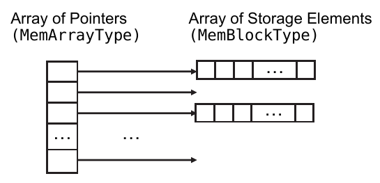

.. _UTILITY/MemoryPkg:

MemoryGenericPkg
################

.. _UTILITY/MemoryPkg/MemoryGenericPkgOverview:

MemoryGenericPkg Overview
*************************

The :vhdlcode:`MemoryGenericPkg` provides an efficient, sparse memory structure and an API that simplifies the creation
of memory models. The memory data structure reduces the amount of memory used during a simulation and hence improves
performance.

There are two primary instances of :vhdlcode:`MemoryGenericPkg`: :vhdlcode:`MemoryPkg_X` and :vhdlcode:`MemoryPkg_NoX`.
:vhdlcode:`MemoryPkg_X` stores 0, 1, X, and U in the memory, and hence, uses two bits per memory bit.
:vhdlcode:`MemoryPkg_NoX` stores 0 and 1 in the memory and uses 1 bit per memory bit.

:vhdlcode:`MemoryPkg` is currently the same as :vhdlcode:`MemoryPkg_X`. The rest of this document will refer to the
usage of :vhdlcode:`MemoryPkg`. The usage of :vhdlcode:`MemoryPkg_X` or :vhdlcode:`MemoryPkg_NoX` is identical.

.. _UTILITY/MemoryPkg/BasicUsage:

Basic Usage
***********

.. _UTILITY/MemoryPkg/PackageReferences:

Package References
==================

Using :vhdlcode:`MemoryGenericPkg` requires at a minimum the following package reference:

.. code-block:: VHDL

   use osvvm.MemoryPkg.all ;
   architecture Test1 of tb is

That said, it is recommended to reference the OSVVM context declaration.

.. code-block:: VHDL

   library OSVVM ;
     context osvvm.OsvvmContext ;

.. _UTILITY/MemoryPkg/CreatingAMemoryID:

Creating a MemoryID
===================

A :vhdlcode:`MemoryID` is a handle to the memory object that is created internal to :vhdlcode:`MemoryPkg`.
:vhdlcode:`MemoryID` has the type :vhdlcode:`MemoryIDType`. :vhdlcode:`MemoryIDType` is a regular type and can be held
in a signal or variable.

.. code-block:: VHDL

   architecture Model of Sram is
     signal MemoryID : MemoryIDType ;
    . . .

.. _UTILITY/MemoryPkg/NewIDConstructTheMemory:

NewID: Construct the Memory
===========================

:vhdlcode:`NewID` allocates and initializes (sizes) the memory data structure. It must be called before any read or
write operations are used.

.. code-block:: VHDL

   MemoryID <= NewID(
                Name      => SRAM'instance_name,
                AddrWidth => Address'length,
                DataWidth => Data'length) ;

Note, here :vhdlcode:`SRAM` is the entity name. If you want separate verification components to share the same memory
model, simply give them the same name, :vhdlcode:`AddrWidth`, and :vhdlcode:`DataWidth` in the call to
:vhdlcode:`NewID`. OTOH, if you don’t want to share memories between separate verification components, then use a unique
name – such as is generated by :vhdlcode:`'instance_name`.

.. _UTILITY/MemoryPkg/MemWriteWritingToTheMemoryModel:

MemWrite: Writing to the Memory Model
=====================================

The procedure :vhdlcode:`MemWrite` writes a value to a storage location in the memory data structure. If this is the
first write to a block of storage elements, the block of storage elements will be allocated before the write starts.

.. code-block:: VHDL

   MemWrite(MemoryID, Address, Data) ;

.. _UTILITY/MemoryPkg/MemReadReadingFromTheMemoryModel:

MemRead: Reading from the Memory Model
======================================

The function :vhdlcode:`MemRead` reads a value from a storage location.

.. code-block:: VHDL

   Data <= MemRead(MemoryID, Address) ;

.. _UTILITY/MemoryPkg/PuttingTheBasicPiecesTogether:

Putting the basic pieces together
=================================

The following puts together the above pieces into a basic SRAM model. Note timing in the form of output propagation
delays and input timing checks have not been added to the model. While these are necessary to complete a memory model
they are a separate issue.

Note that both :vhdlcode:`RamWriteProc` and :vhdlcode:`ReadProc` use wait statements at the beginning of the process.
This allows :vhdlcode:`NewID`, which runs during initialization to complete before either :vhdlcode:`MemWrite` or
:vhdlcode:`MemRead` can run. This is essential since the memory does not exist until :vhdlcode:`NewID` is called.

.. code-block:: VHDL

   library ieee ;
     use ieee.std_logic_1164.all ;
     use ieee.numeric_std.all ;
   library OSVVM ;
     context osvvm.OsvvmContext ;

   Entity SRAM is
   port (
     Address : in     std_logic_vector (19 downto 0) ;
     Data    : inout  std_logic_vector (15 downto 0) ;
     nCE     : in     std_logic ;
     nOE     : in     std_logic ;
     nWE     : in     std_logic
   ) ;
   end SRAM ;
   Architecture model of SRAM is
     signal MemoryID : MemoryIDType ;
     signal WriteEnable, ReadEnable  : std_logic ;
   begin
     MemoryID <= NewID(
                   Name      => SRAM'instance_name,
                   AddrWidth => Address'length,
                   DataWidth => Data'length) ;

     WriteEnable <= not nWE and not nCE ;

     RamWriteProc : process
     begin
       wait until falling_edge(WriteEnable) ;
       MemWrite(MemoryID, Address, Data) ;
     end process RamWriteProc  ;

     ReadEnable <= not nCE and not nOE ;

     ReadProc : process
     begin
       wait on Address, ReadEnable ;
       case ReadEnable is
         when '1' =>       Data <=  MemRead(MemoryID, Address) ;
         when '0' =>       Data <= (Data'range => 'Z') ;
         when others =>    Data <= (Data'range => 'X') ;
       end case ;
     end process ReadProc ;
   end model ;

.. _UTILITY/MemoryPkg/MemoryAPIReference:

Memory API Reference
********************

The intent of the API is to make creation of efficient memory models easy. Furthermore, to make the creation of shared
memories that are in separate components easy.

Behind the simple API are some rather interesting data structures. There is a
:ref:`brief discussion of the data structures <UTILITY/MemoryPkg/DataStructure>` at the end of this document. The
important thing to note is that you do not need to understand the data structures to be able to use
:vhdlcode:`MemoryPkg` to create efficient memories.

.. _UTILITY/MemoryPkg/NewIDAndSupportingTypes:

NewID and Supporting Types
==========================

.. _UTILITY/MemoryPkg/NewIDDataStructureConstructor:

NewID: Data Structure Constructor
---------------------------------

:vhdlcode:`NewID` allocates and initializes (sizes) the memory data structure. It must be called before any read or
write operations are used.

.. code-block:: VHDL

   impure function NewID (
     Name                : String ;
     AddrWidth           : integer ;
     DataWidth           : integer ;
     ParentID            : AlertLogIDType          := OSVVM_MEMORY_ALERTLOG_ID ;
     ReportMode          : AlertLogReportModeType  := ENABLED ;
     Search              : NameSearchType          := PRIVATE_NAME ;
     PrintParent         : AlertLogPrintParentType := PRINT_NAME_AND_PARENT
   ) return MemoryIDType ;

:vhdlcode:`NewID` also creates an :vhdlcode:`AlertLogID` for the data structure using the value of the name parameter
and the value of :vhdlcode:`ParentID`. If :vhdlcode:`AddrWidth` is greater than 38 bits, a warning is produced.
:vhdlcode:`AddrWidth` is limited to being 41 bits. This creates an array that is :vhdlcode:`2**AddrWidth-BLOCK_SIZE` in
length.

.. _UTILITY/MemoryPkg/MemoryIDType:

MemoryIDType
------------

:vhdlcode:`MemoryIDType` is defined as follows.

.. code-block:: VHDL

   type MemoryIDType is record
     ID : integer_max ;
   end record MemoryIDType ;

.. _UTILITY/MemoryPkg/AlertLogReportModeType:

AlertLogReportModeType
----------------------

.. code-block:: VHDL

   type AlertLogReportModeType is (DISABLED, ENABLED, NONZERO) ;

When :vhdlcode:`DISABLED`, an :vhdlcode:`AlertLogID` does not print in :vhdlcode:`ReportAlerts` (text reports) or
:vhdlcode:`WriteAlertYaml` (Yaml/HTML reports). When :vhdlcode:`NONZERO`, an :vhdlcode:`AlertLogID` does not print in
:vhdlcode:`ReportAlerts`, but prints in :vhdlcode:`WriteAlertYaml`. Hence, :vhdlcode:`NONZERO` shortens the text reports
to what is essential. When :vhdlcode:`ENABLED`, an :vhdlcode:`AlertLogID` prints in :vhdlcode:`ReportAlerts` and
:vhdlcode:`WriteAlertYaml`.

None of these settings impact printing in :vhdlcode:`Alert` or :vhdlcode:`Log`.

:vhdlcode:`DISABLED` is intended to be used for data structures that are not used for self-checking and may produce
errors on parameter checks. These errors are not lost as they are still accumulated in the parent ID.

.. _UTILITY/MemoryPkg/AlertLogPrintParentType:

AlertLogPrintParentType
-----------------------

.. code-block:: VHDL

   type AlertLogPrintParentType is (PRINT_NAME, PRINT_NAME_AND_PARENT) ;

When :vhdlcode:`PRINT_NAME`, :vhdlcode:`Alert` and :vhdlcode:`Log` print the name of the :vhdlcode:`AlertLogID`. When
:vhdlcode:`PRINT_NAME_AND_PARENT`, :vhdlcode:`Alert` and :vhdlcode:`Log` print the parent ID name, the ID separator, and
then the ID name.

.. _UTILITY/MemoryPkg/NameSearchType:

NameSearchType
--------------

.. code-block:: VHDL

   type NameSearchType is (
       PRIVATE_NAME, NAME, NAME_AND_PARENT, NAME_AND_PARENT_ELSE_PRIVATE) ;

When :vhdlcode:`NewID` is called, first a search of existing IDs is done. If there is a match, that ID is returned, if
there is not, a new one is created. Matching is determined by the ID, :vhdlcode:`ParentID`, and :vhdlcode:`Search`
parameters. If the :vhdlcode:`Search` parameter is :vhdlcode:`PRIVATE_NAME`, no searching is done and a new ID is
created. If the :vhdlcode:`Search` parameter is :vhdlcode:`NAME`, then any ID whose name matches is returned. If the
:vhdlcode:`Search` parameter is :vhdlcode:`NAME_AND_PARENT`, then any ID whose name and :vhdlcode:`ParentID` match or
:vhdlcode:`NAME` and stored :vhdlcode:`Search` parameter is :vhdlcode:`NAME` is returned.

Hence, to share a memory, construct the data structure in one entity (such as a verification component) and look up the
data structure in another entity (such as the test sequencer). This is illustrated below:

.. code-block:: VHDL

   -- Construct Data Structure in VC         -- Look up data structure in test sequencer
   entity Axi4Memory is                      architecture Test1 of TestCtrl is
   . . .                                     . . .
   Initialize : process
     variable MemID : MemoryIDType;          MemTestProc : process
   begin                                       variable MemID : MemoryIDType;
     -- construct                            begin
     MemID := NewID(                           -- look up
       Name       => MEM_NAME,                 MemID := NewID(
       AddrWidth  => ADDR_WIDTH,                 Name       =>  MEM_NAME,
       DataWidth  => DATA_WIDTH,                 AddrWidth  =>  ADDR_WIDTH,
       Search     => NAME  ) ;                   DataWidth  =>  DATA_WIDTH,
     . . .                                       Search     =>  NAME ) ;

                                               MemRead (MemID, A1, D1) ;
                                               MemWrite(MemID, A1, D1+5) ;
                                               . . .

.. _UTILITY/MemoryPkg/MemWriteAndWrite:

MemWrite (and Write)
====================

:vhdlcode:`MemWrite` writes to a memory location. If the corresponding block of storage is not yet allocated, then it
will be allocated before the write.

.. code-block:: VHDL

   procedure MemWrite (
     ID    : MemoryIDType ;
     Addr  : std_logic_vector ;
     Data  : std_logic_vector
   ) ;

If any address bit is an 'X', an alert will be signaled and the write is ignored. If any data bit is an 'X', the current
policy makes the entire data word all 'X's. An alert of severity failure is generated if the memory was not already
constructed with :vhdlcode:`NewID`.

It is an error if the :vhdlcode:`Addr` contains more bits than :vhdlcode:`AddrWidth` (the initialized size of memory)
and those bits are non-zero.

.. _UTILITY/MemoryPkg/MemReadAndRead:

MemRead (and Read)
==================

:vhdlcode:`MemRead` reads from a memory location. It is available as either a function or procedure.

.. code-block:: VHDL

   procedure MemRead (
     ID    : in MemoryIDType ;
     Addr  : in  std_logic_vector ;
     Data  : out std_logic_vector
   ) ;
   impure function MemRead (
     ID    : MemoryIDType ;
     Addr  : std_logic_vector
   ) return std_logic_vector ;

If the address has an 'X' in it, an alert will be signaled and the value returned will be all 'X's. If the corresponding
block of storage is not allocated, the value returned will be all 'U's. If the block of storage is allocated, but the
value has not been written to yet, the current policy returns all 'X's. An alert of severity failure is generated if the
memory was not already constructed with :vhdlcode:`NewID`.

It is an error if the :vhdlcode:`Addr` contains more bits than :vhdlcode:`AddrWidth` (the initialized size of memory)
and those bits are non-zero.

.. _UTILITY/MemoryPkg/MemErase:

MemErase
========

:vhdlcode:`MemErase` deallocates all block of storage blocks. However, it does not deallocate the base structure of the
memory. :vhdlcode:`MemErase` is useful for erasing the memory between tests.

.. code-block:: VHDL

   procedure MemErase (ID : in MemoryIDType) ;

.. _UTILITY/MemoryPkg/GetAlertLogID:

GetAlertLogID
=============

:vhdlcode:`GetAlertLogID` returns the :vhdlcode:`AlertLogID` associated with a memory.

.. code-block:: VHDL

   impure function GetAlertLogID (ID : in MemoryIDType) return AlertLogIDType ;

.. _UTILITY/MemoryPkg/FileReadHAndFileReadB:

FileReadH and FileReadB
=======================

:vhdlcode:`FileReadH` and :vhdlcode:`FileReadB` are designed to mimic Verilog system functions ``$readmemh`` and
``$readmemb``.

.. code-block:: VHDL

   procedure FileReadH (    -- Hexadecimal File Read
     ID           : MemoryIDType ;
     FileName     : string ;
     StartAddr    : std_logic_vector ;
     EndAddr      : std_logic_vector
   ) ;
   procedure FileReadH (
     ID           : MemoryIDType ;
     FileName     : string ;
     StartAddr    : std_logic_vector
   ) ;
   procedure FileReadH (
     ID           : MemoryIDType ;
     FileName     : string
   ) ;

   procedure FileReadB (    -- Binary File Read
     ID           : MemoryIDType ;
     FileName     : string ;
     StartAddr    : std_logic_vector ;
     EndAddr      : std_logic_vector
   ) ;
   procedure FileReadB (
     ID           : MemoryIDType ;
     FileName     : string ;
     StartAddr    : std_logic_vector
   ) ;
   procedure FileReadB (
     ID           : MemoryIDType ;
     FileName     : string
   ) ;

The file shall contain only the following:

* White space (spaces, new lines, tabs, and form-feeds)
* Comments (either //, #, or --)
* @ character (designating the adjacent number is an address)
* Binary or hexadecimal numbers

Addresses specified in the call to :vhdlcode:`FileReadH` or :vhdlcode:`FileReadB` provide both an initial starting
address and a range of valid addresses for memory operations. Addressing advances from :vhdlcode:`StartAddr` to
:vhdlcode:`EndAddr`. If :vhdlcode:`EndAddr` is greater than :vhdlcode:`StartAddr`, then the next address is one larger
than the current one, otherwise, the next address is one less than the current address.

Addresses may also be specified in the file in the format '@' followed by a hexadecimal number as shown below. There
shall not be any space between the '@' and the number. The address read must be between :vhdlcode:`StartAddr` and
:vhdlcode:`EndAddr` or a FAILURE is generated.

.. code-block:: text

   @hhhhh

Values not preceded by an '@' character are data values. Data values must be separated by white space or comments from
other values. :vhdlcode:`FileReadH` requires hexadecimal values compatible with :vhdlcode:`hread` for
:vhdlcode:`std_ulogic_vector`. :vhdlcode:`FileReadB` requires values compatible with :vhdlcode:`read` for
:vhdlcode:`std_ulogic`.

In the current implementation, if more digits are read than are required by the memory, left hand characters will be
dropped provided they are 0. If fewer digits are read than are required by the memory, 0 characters are added to the
left hand side. Note that this behavior may change in the future to support stricter conformance between data in the
file and the data width of the memory.

.. _UTILITY/MemoryPkg/FileWriteHAndFileWriteB:

FileWriteH and FileWriteB
=========================

:vhdlcode:`FileWriteH` and :vhdlcode:`FileWriteB` are designed to mimic Verilog system functions ``$writememh`` and
``$writememb``.

.. code-block:: VHDL

   procedure FileWriteH (    -- Hexadecimal File Write
     ID           : MemoryIDType ;
     FileName     : string ;
     StartAddr    : std_logic_vector ;
     EndAddr      : std_logic_vector
   ) ;
   procedure FileWriteH (
     ID           : MemoryIDType ;
     FileName     : string ;
     StartAddr    : std_logic_vector
   ) ;
   procedure FileWriteH (
     ID           : MemoryIDType ;
     FileName     : string
   ) ;

   procedure FileWriteB (    -- Binary File Write
     ID           : MemoryIDType ;
     FileName     : string ;
     StartAddr    : std_logic_vector ;
     EndAddr      : std_logic_vector
   ) ;
   procedure FileWriteB (
     ID           : MemoryIDType ;
     FileName     : string ;
     StartAddr    : std_logic_vector
   ) ;
   procedure FileWriteB (
     ID           : MemoryIDType ;
     FileName     : string
   ) ;

Address and data values are written one per line. Address values are preceded by an @ character. Values that are X or
values that correspond to a block of storage elements that have not been allocated will not be written out.

.. _UTILITY/MemoryPkg/GenericsAndInstancesOfMemoryGenericPkg:

Generics and Instances of MemoryGenericPkg
******************************************

.. _UTILITY/MemoryPkg/GenericInterface:

Generic Interface
=================

The generic interface for :vhdlcode:`MemoryGenericPkg` is shown below.

.. code-block:: VHDL

   package MemoryGenericPkg is
     generic (
   --    type MemoryBaseType ;
       function SizeMemoryBaseType(Size : integer) return integer ; -- is <> ;
       function ToMemoryBaseType  (A : std_logic_vector ; Size : integer) return
   MemoryBaseType ; -- is <> ;
       function FromMemoryBaseType(A : MemoryBaseType   ; Size : integer) return
   std_logic_vector ; -- is <> ;
       function InitMemoryBaseType(Size : integer) return MemoryBaseType -- is <>
     ) ;

:vhdlcode:`MemoryBaseType` is currently a subtype of :vhdlcode:`integer_vector`. The original intent was to use either
:vhdlcode:`integer_vector` or :vhdlcode:`bit_vector` but that was too much at the bleeding edge of tool support.

.. _UTILITY/MemoryPkg/InstancesOfMemoryGenericPkg:

Instances of MemoryGenericPkg
=============================

There are two primary instances of :vhdlcode:`MemoryGenericPkg`: :vhdlcode:`MemoryPkg_UX01` and
:vhdlcode:`MemoryPkg_01`. :vhdlcode:`MemoryPkg_UX01` stores 0, 1, X, and U in the memory, and hence, uses two bits per
memory bit.

.. code-block:: VHDL

   use work.MemorySupportPkg.all ;
   package MemoryPkg_UX01 is new work.MemoryGenericPkg
     generic map (
   --    MemoryBaseType      => MemoryBaseType_UX01,
       SizeMemoryBaseType  => SizeMemoryBaseType_UX01,
       ToMemoryBaseType    => ToMemoryBaseType_UX01,
       FromMemoryBaseType  => FromMemoryBaseType_UX01,
       InitMemoryBaseType  => InitMemoryBaseType_UX01
     ) ;

:vhdlcode:`MemoryPkg_01` stores 0 and 1 in the memory and uses 1 bit per memory bit.

.. code-block:: VHDL

   use work.MemorySupportPkg.all ;
   package MemoryPkg_01 is new work.MemoryGenericPkg
     generic map (
   --    MemoryBaseType      => MemoryBaseType_01,
       SizeMemoryBaseType  => SizeMemoryBaseType_01,
       ToMemoryBaseType    => ToMemoryBaseType_01,
       FromMemoryBaseType  => FromMemoryBaseType_01,
       InitMemoryBaseType  => InitMemoryBaseType_01
     ) ;

The storage policies of these packages are defined by the type :vhdlcode:`MemoryBaseType` (currently fixed at
:vhdlcode:`integer_vector`) and the generic functions, :vhdlcode:`SizeMemoryBaseType`, :vhdlcode:`ToMemoryBaseType`,
:vhdlcode:`FromMemoryBaseType`, and :vhdlcode:`InitMemoryBaseType`.

There is also a package instance named :vhdlcode:`MemoryPkg_orig`. This implements the “original” storage policies that
:vhdlcode:`MemoryPkg` used. The storage policy for this package uses a single integer value and uses the left most bit
of the integer to indicate whether the value is an X or not. As a result, only 31 bits can be stored in the memory and
if an X is stored in any bit, they all read back as an X. Its usage is not recommended – instead use
:vhdlcode:`MemoryPkg_UX01` or :vhdlcode:`MemoryPkg_01`.

Note that the package instances :vhdlcode:`MemoryPkg_X` or :vhdlcode:`MemoryPkg_NoX` are soft deprecated – they still
exist for backward compatibility, but use :vhdlcode:`MemoryPkg_UX01` or :vhdlcode:`MemoryPkg_01` for new projects.

.. _UTILITY/MemoryPkg/SelectingTheInstanceOfMemoryPkg:

Selecting the Instance of MemoryPkg
***********************************

By default, :vhdlcode:`MemoryPkg` uses the UX01 policy. If the Tcl setting variable :tclcode:`$::osvvm::UseMemoryPkg01`
is true then policy 01 is used. See :ref:`OSVVM Settings User guide <UTILITY/OsvvmSettings>` for how to change this
setting.

.. _UTILITY/MemoryPkg/ABetterWayOfCallingNewIDNotYet:

A Better Way of Calling NewID? Not yet.
***************************************

As an ordinary type, :vhdlcode:`MemoryID` could be a constant and :vhdlcode:`NewID` called in the constant declaration
as follows:

.. code-block:: VHDL

   constant MemoryID : MemoryIDType :=
              NewID(
                Name       =>  Axi4Memory'instance_name,
                AddrWidth  =>  Addr'length,
                DataWidth  =>  Data'length ) ;

One big benefit of this is that :vhdlcode:`NewID` is called during elaboration of the design before :vhdlcode:`MemRead`
or :vhdlcode:`MemWrite` run.

While the tools we test with allow this, unfortunately the language does not. We plan to address this in the next
revision of the language. See: https://gitlab.com/IEEE-P1076/VHDL-Issues/-/issues/75

.. _UTILITY/MemoryPkg/DataStructure:

Data Structure
**************

:vhdlcode:`MemoryGenericPkg` contains a singleton data structure that allows a simple API to be created to a memory data
structure. The singleton data structure allows a dynamic array of memory objects to be created. Don’t worry the
complexity of this is hidden from users of the package.

When :vhdlcode:`NewID` is called, an additional element is added to the dynamic array. This element implements a sparse
memory data structure. :vhdlcode:`NewID` returns a value of :vhdlcode:`MemoryIDType`. This value is the handle to the
memory.

The sparse memory data structure used by each element in the dynamic array of memories consists of an array of pointers
to a block of storage elements. A block of storage elements is nominally an array of 1024 values. This structure is
shown in :ref:`Figure 1 <UTILITY/MemoryPkg/Figure1>`.

   Figure 1. Allocation Structure of MemoryGenericPkg

The Array of Pointers is created when the memory is initialized by the call to :vhdlcode:`NewID`. A block of storage is
allocated when a write operation writes to a location within the block. This data structure minimizes workstation memory
usage when only a portion of the RAM model is used.

Currently storage elements are type integer. Storing a :vhdlcode:`std_logic_vector` into an integer requires a policy.
The current storage policy is that if there is an 'X' in any bit of the :vhdlcode:`std_logic_vector`, then the value is
stored as -1. An uninitialized value is :vhdlcode:`integer'left`. As a result, that allows up to 31 bits of
:vhdlcode:`std_logic_vector` to be stored into a storage element. The future plan is for the storage element type and
storage policy to be determined by package generics.

.. _UTILITY/MemoryPkg/WhatAboutTheOlderRevisionsOfMemoryPkg:

What about the older revisions of MemoryPkg?
********************************************

Versions of :vhdlcode:`MemoryPkg` before 2021.06 were solely protected type based. That use model is still supported,
however, it is deprecated and not talked about here. If you need the documentation for it, see the subdirectory
:file:`ProtectedTypes_the_old_way` in the Documentation repository.

.. _UTILITY/MemoryPkg/CompilingAndUsingOSVVMUtilityLibrary:

Compiling and Using OSVVM Utility Library
*****************************************

Reference all packages in the OSVVM Utility library by using the context declaration:

.. code-block:: VHDL

   library OSVVM ;
     context osvvm.OsvvmContext ;

Compilation order for OSVVM Utility Library is in :osvvmdoc:`OSVVM_release_notes.pdf <osvvm_release_notes>`. Rather than
learning this, we recommend using the OSVVM compilation scripts.

OSVVM Utility library is released under the Apache open source license. It is free (both to download and use - there are
no license fees). You can download it from osvvm.org or from our development area on GitHub
(https://github.com/OSVVM/OSVVM).

If you add features to the package, please donate them back under the same license as candidates to be added to the
standard version of the package. If you need features, be sure to contact us.

We also support the OSVVM user community and blogs through http://www.osvvm.org. Interested in sharing about your
experience using OSVVM? Let us know, you can blog about it at osvvm.org.
