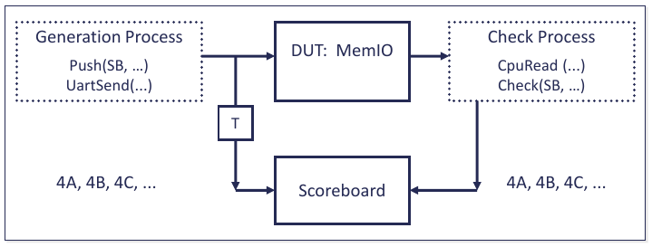

.. _UTILITY/ScoreboardPkg:

Scoreboard Generic Package
##########################

.. _UTILITY/ScoreboardPkg/ScoreboardGenericPkgOverview:

ScoreboardGenericPkg Overview
*****************************

A scoreboard is a data structure used for self-checking in an environment where inputs are closely related to outputs,
such as in data transmission (UART, AxiStream, …).

A basic usage of a scoreboard is:

* On the stimulus generation side, we generate the stimulus, push the stimulus into the scoreboard, and then send the
  transaction to the interface (:vhdlcode:`UartSend`).
* On the stimulus check side, we receive a transaction (:vhdlcode:`CpuRead`) and use the scoreboard to check the value.

This is shown in the figure below.

.. _UTILITY/ScoreboardPkg/BasicUsage:

Basic Usage
***********

.. _UTILITY/ScoreboardPkg/PackageReferences:

Package References
==================

The Scoreboard package instances are not in the OSVVM context declaration, so you will need to include them separately.

.. code-block:: VHDL

   library OSVVM ;
     context osvvm.OsvvmContext ;
     use osvvm.ScoreboardPkg_slv.all ;

.. _UTILITY/ScoreboardPkg/CreateAScoreboardID:

Create a Scoreboard ID
======================

A Scoreboard ID is a handle to the scoreboard object that is created internal to an instance of
:vhdlcode:`ScoreboardGenericPkg`. A Scoreboard ID has the type :vhdlcode:`ScoreboardIDType`.
:vhdlcode:`ScoreboardIDType` is a regular type and can be held in a signal or variable.

.. code-block:: VHDL

   architecture Uart_Test1 of TestCtrl is
     signal SB : ScoreboardIDType ;

If more than one scoreboard package instance is referenced, the :vhdlcode:`ScoreboardIDType` must be disambiguated using
a fully selected name.

.. code-block:: VHDL

   architecture Uart_Test1 of TestCtrl is
     use osvvm.ScoreboardPkg_slv.all ;
     use osvvm.ScoreboardPkg_int.all ;

     signal SB_slv  : osvvm.ScoreboardPkg_slv.ScoreboardIDType ;
     signal SB_int  : osvvm.ScoreboardPkg_int.ScoreboardIDType;

.. _UTILITY/ScoreboardPkg/ConstructTheScoreboard:

Construct the Scoreboard
========================

:vhdlcode:`NewID` allocates and initializes (sizes) the memory data structure. It must be called before any read or
write operations are used.

.. code-block:: VHDL

   SB <= NewID("UART_SB") ;

.. _UTILITY/ScoreboardPkg/PushBeforeSend:

Push Before Send
================

In the stimulus generation process, push the expected value into the scoreboard before sending the transaction.

.. code-block:: VHDL

   Push(SB, X"10") ;
   UartSend(UartTxRec, X"10") ;

.. _UTILITY/ScoreboardPkg/GetBeforeCheck:

Get before Check
================

In the stimulus checking process, receive an actual transaction value (:vhdlcode:`UartGet`) and then check the value
using the scoreboard.

.. code-block:: VHDL

   UartGet(UartRxRec, RcvD) ;
   Check(SB, RcvD) ;

.. _UTILITY/ScoreboardPkg/PuttingTheBasicPiecesTogether:

Putting the basic pieces together
=================================

The following is a basic use model of the scoreboard. For more information on how OSVVM structures test cases and test
processes, see the :ref:`FRAMEWORK/TestWriters`.

.. code-block:: VHDL

   architecture Uart_Test1 of TestCtrl is
     signal SB : ScoreboardIDType ;
     . . .
   begin
     ControlProc : process
     begin
       SetAlertLogName("UART_Test1") ;
       SB <= NewID("UART_SB") ;
       wait until nReset = '1' ;
       WaitForBarrier(TestStart) ;
       WaitForBarrier(TestDone, 5 ms) ;
       ReportAlerts ;
       std.env.stop(GetAlertCount) ;
       wait ;
     end process ControlProc ;

     GenerateProc : process
     begin
       WaitForBarrier(TestStart) ;
       Push(SB, X"10") ;
       UartSend(UartTxRec, X"10") ;
       . . .
       Push(SB, X"FF") ;
       UartSend(UartTxRec, X"FF") ;
       TestDone <= TRUE ;
       WaitForBarrier(TestDone) ;
       wait ;
     end process GenerateProc ;

     CheckProc : process
       variable RcvD : std_logic_vector(7 downto 0);
     begin
       WaitForBarrier(TestStart) ;
       while not TestDone loop
         UartGet(UartRxRec, RcvD) ;
         Check(SB, RcvD) ;
         wait for UART_BAUD_PERIOD ;
       end loop ;
       WaitForBarrier(TestDone) ;
       wait ;
     end process CheckProc ;
   end architecture UART_Test1 ;

Note that the test generation process generates numerous values using either directed (shown) or random methods, the
checking side is a simple loop. Hence, the big advantage of using a scoreboard is that the checking side remains simple
and has no need to know what the test generation side is doing.

.. _UTILITY/ScoreboardPkg/UsingScoreboardGenericPkgPackageGenerics:

Using ScoreboardGenericPkg Package Generics
*******************************************

The scoreboard package uses package generics to allow the :vhdlcode:`ExpectedType` (transaction value sent) and
:vhdlcode:`ActualType` (transaction value received) to be different for different applications. The function
:vhdlcode:`Match` is used to determine if the Actual value matches the Expected Value. This supports checking that is
more complicated than a simple "=" check. The functions :vhdlcode:`expected_to_string` and :vhdlcode:`actual_to_string`
help printing values of :vhdlcode:`ExpectedType` and :vhdlcode:`ActualType` respectively. Hence, the interface to the
package is:

.. code-block:: VHDL

   package ScoreboardGenericPkg is
   generic(
     type ExpectedType ;
     type ActualType ;
     impure function Match( Actual : ActualType ;
                     Expected : ExpectedType) return boolean ;
     Impure function expected_to_string(A: ExpectedType) return string;
     Impure function actual_to_string  (A: ActualType)   return string
   ) ;

To use the scoreboard for your tests, you will need to create a package instance. The following example creates a
scoreboard for :vhdlcode:`integer`. Note often you will need to reference the package that defines your types and
functions that correspond to :vhdlcode:`ExpectedType`, :vhdlcode:`ActualType`, :vhdlcode:`match`,
:vhdlcode:`expected_to_string`, and :vhdlcode:`actual_to_string`, however, here for :vhdlcode:`integer` all types and
functions are available in package :vhdlcode:`std.standard` which is implicitly visible.

.. code-block:: VHDL

   -- reference the package that defines types and functions.
   -- use std.standard.all ; -- implicitly included
   package ScoreboardPkg_int is new osvvm.ScoreboardGenericPkg
     generic map (
       ExpectedType        =>  integer,
       ActualType          =>  integer,
       match               =>  std.standard."=",
       expected_to_string  =>  to_string,
       actual_to_string    =>  to_string
     ) ;

.. _UTILITY/ScoreboardPkg/PredefinedInstancesOfScoreboardGenericPkgInOSVVMLibrary:

Predefined Instances of ScoreboardGenericPkg in OSVVM Library
*************************************************************

The OSVVM library defines scoreboard instances for :vhdlcode:`integer` (:vhdlcode:`ScoreboardPkg_int`),
:vhdlcode:`integer_vector` (:vhdlcode:`ScoreboardPkg_IntV`), :vhdlcode:`std_logic_vector`
(:vhdlcode:`ScoreboardPkg_slv`), :vhdlcode:`unsigned` (:vhdlcode:`ScoreboardPkg_unsigned`), and :vhdlcode:`signed`
(:vhdlcode:`ScoreboardPkg_signed`).

.. _UTILITY/ScoreboardPkg/MySimulatorDoesNotSupportPackageGenerics:

My Simulator Does Not Support Package Generics
**********************************************

All the simulators we test with support package generics. However, we still have you covered. Copy
:file:`ScoreboardGenericPkg.vhd` to :file:`ScoreboardPkg_integer_c.vhd`. Comment out the generics. Uncomment the subtype
and alias declarations that correspond to the generics (they have the same name). Configure these aliases exactly as
described in the section titled
":ref:`Using ScoreboardGenericPkg Package Generics <UTILITY/ScoreboardPkg/UsingScoreboardGenericPkgPackageGenerics>`".

The top of your resulting package should look as follows:

.. code-block:: VHDL

   -- reference the package that defines types and functions.
   -- use std.standard.all ; -- implicitly included
   package ScoreBoardPkg_integer is
     subtype ExpectedType is integer ;
     subtype ActualType   is integer ;
     alias match is std.standard."=" [integer, integer
                                         return boolean] ;
     alias expected_to_string is
       to_string [integer return string];
     alias actual_to_string is
       to_string [integer return string] ;

.. _UTILITY/ScoreboardPkg/ScoreboardAPIReference:

Scoreboard API Reference
************************

The intent of the API is to make the creation of a scoreboard easy. The OSVVM scoreboard goes beyond simple though in
that it supports out of order execution (via tags) and arrays of scoreboards (via effective use of abstractions). Tags
are implemented as an additional string parameter on push, pop, and check.

Behind the simple API are some rather interesting data structures. The important thing to note is that you do not need
to understand the data structures to be able to use :vhdlcode:`ScoreboardGenericPkg`.

Caution, features not documented here are either considered experimental or have been deprecated (and may be removed in
a future version). If you decide to use it and want it to stay around, be sure to let us know.

.. _UTILITY/ScoreboardPkg/NewIDAndSupportingTypes:

NewID and Supporting Types
==========================

.. _UTILITY/ScoreboardPkg/NewIDDataStructureConstructor:

NewID: Data Structure Constructor
---------------------------------

:vhdlcode:`NewID` allocates and initializes the scoreboard data structure. It must be called before any other scoreboard
operations are used.

.. code-block:: VHDL

   impure function NewID (
     Name          : String ;
     ParentID      : AlertLogIDType          := OSVVM_SCOREBOARD_ALERTLOG_ID ;
     ReportMode    : AlertLogReportModeType  := ENABLED ;
     Search        : NameSearchType          := PRIVATE_NAME ;
     PrintParent   : AlertLogPrintParentType := PRINT_NAME_AND_PARENT
   ) return ScoreboardIDType ;

:vhdlcode:`NewID` also creates an :vhdlcode:`AlertLogID` for the data structure using the value of the name parameter
and the value of :vhdlcode:`ParentID`.

.. _UTILITY/ScoreboardPkg/ScoreboardIDType:

ScoreboardIDType
----------------

:vhdlcode:`ScoreboardIDType` is defined as follows.

.. code-block:: VHDL

   type ScoreboardIDType is record
     ID : integer_max ;
   end record ScoreboardIDType ;

.. _UTILITY/ScoreboardPkg/AlertLogReportModeType:

AlertLogReportModeType
----------------------

.. code-block:: VHDL

   type AlertLogReportModeType is (DISABLED, ENABLED, NONZERO) ;

When :vhdlcode:`DISABLED`, an :vhdlcode:`AlertLogID` does not print in :vhdlcode:`ReportAlerts` (text reports) or
:vhdlcode:`WriteAlertYaml` (Yaml/HTML reports). When :vhdlcode:`NONZERO`, an :vhdlcode:`AlertLogID` does not print in
:vhdlcode:`ReportAlerts`, but prints in :vhdlcode:`WriteAlertYaml`. Hence, :vhdlcode:`NONZERO` shortens the text reports
to what is essential. When :vhdlcode:`ENABLED`, an :vhdlcode:`AlertLogID` prints in :vhdlcode:`ReportAlerts` and
:vhdlcode:`WriteAlertYaml`.

None of these settings impact printing in :vhdlcode:`Alert` or :vhdlcode:`Log`.

:vhdlcode:`DISABLED` is intended to be used for data structures that are not used for self-checking and may produce
errors on parameter checks. These errors are not lost as they are still accumulated in the parent ID.

.. _UTILITY/ScoreboardPkg/AlertLogPrintParentType:

AlertLogPrintParentType
-----------------------

.. code-block:: VHDL

   type AlertLogPrintParentType is (PRINT_NAME, PRINT_NAME_AND_PARENT) ;

When :vhdlcode:`PRINT_NAME`, :vhdlcode:`Alert` and :vhdlcode:`Log` print the name of the :vhdlcode:`AlertLogID`. When
:vhdlcode:`PRINT_NAME_AND_PARENT`, :vhdlcode:`Alert` and :vhdlcode:`Log` print the parent ID name, the ID separator, and
then the ID name.

.. _UTILITY/ScoreboardPkg/NameSearchType:

NameSearchType
--------------

.. code-block:: VHDL

   type NameSearchType is (
       PRIVATE_NAME, NAME, NAME_AND_PARENT, NAME_AND_PARENT_ELSE_PRIVATE) ;

When :vhdlcode:`NewID` is called, first a search of existing IDs is done. If there is a match, that ID is returned, if
there is not, a new one is created. Matching is determined by the ID, :vhdlcode:`ParentID`, and :vhdlcode:`Search`
parameters. If the :vhdlcode:`Search` parameter is :vhdlcode:`PRIVATE_NAME`, no searching is done and a new ID is
created. If the :vhdlcode:`Search` parameter is :vhdlcode:`NAME`, then any ID whose name matches is returned. If the
:vhdlcode:`Search` parameter is :vhdlcode:`NAME_AND_PARENT`, then any ID whose name and :vhdlcode:`ParentID` match or
:vhdlcode:`NAME` and stored :vhdlcode:`Search` parameter is :vhdlcode:`NAME` is returned.

.. _UTILITY/ScoreboardPkg/Push:

Push
====

:vhdlcode:`Push` adds the expected value (:vhdlcode:`ExpectedType`) to the scoreboard.

.. code-block:: VHDL

   -- Simple Scoreboard, no tag
   procedure Push (
     constant ID     : in  ScoreboardIDType ;
     constant Item   : in  ExpectedType
   ) ;

   -- Simple Tagged Scoreboard
   procedure Push (
     constant ID     : in  ScoreboardIDType ;
     constant Tag    : in  string ;
     constant Item   : in  ExpectedType
   ) ;

.. _UTILITY/ScoreboardPkg/Check:

Check
=====

Check a received value (:vhdlcode:`ActualType`) with value in scoreboard. The :vhdlcode:`Match` function is used to
determine if the received and expected values match. Checking is handled by :vhdlcode:`AffirmIf`. As a result, if they
match a log PASSED is generated, otherwise, an alert ERROR is generated.

.. code-block:: VHDL

   -- Simple Scoreboard, no tag
   procedure Check (
     constant ID           : in  ScoreboardIDType ;
     constant ActualData   : in ActualType
   ) ;

   -- Simple Tagged Scoreboard
   procedure Check (
     constant ID           : in  ScoreboardIDType ;
     constant Tag          : in  string ;
     constant ActualData   : in  ActualType
   ) ;

.. _UTILITY/ScoreboardPkg/Pop:

Pop
===

The scoreboard can also be used as a FIFO. :vhdlcode:`Pop` removes the expected value from the top of the FIFO (oldest
value) and returns it. :vhdlcode:`Pop` is supported as either a procedure or function.

.. code-block:: VHDL

   -- Simple Scoreboard, no tag
   procedure Pop (
     constant ID     : in  ScoreboardIDType ;
     variable Item   : out  ExpectedType
   ) ;

   -- Simple Tagged Scoreboard
   procedure Pop (
     constant ID     : in  ScoreboardIDType ;
     constant Tag    : in  string ;
     variable Item   : out  ExpectedType
   ) ;

   -- Simple Scoreboard, no tag
   impure function Pop (
     constant ID     : in  ScoreboardIDType
   ) return ExpectedType ;

   -- Simple Tagged Scoreboard
   impure function Pop (
     constant ID     : in  ScoreboardIDType ;
     constant Tag    : in  string
   ) return ExpectedType ;

.. _UTILITY/ScoreboardPkg/Peek:

Peek
====

:vhdlcode:`Peek` returns the expected value from the top of the FIFO (oldest value) without removing it.
:vhdlcode:`Peek` is supported as either a procedure or function.

.. code-block:: VHDL

   -- Simple Tagged Scoreboard
   procedure Peek (
     constant ID     : in  ScoreboardIDType ;
     constant Tag    : in  string ;
     variable Item   : out ExpectedType
   ) ;

   -- Simple Scoreboard, no tag
   procedure Peek (
     constant ID     : in  ScoreboardIDType ;
     variable Item   : out  ExpectedType
   ) ;

   -- Tagged Scoreboards
   impure function Peek (
     constant ID     : in  ScoreboardIDType ;
     constant Tag    : in  string
   ) return ExpectedType ;

   -- Simple Scoreboard
   impure function Peek (
     constant ID     : in  ScoreboardIDType
   ) return ExpectedType ;

.. _UTILITY/ScoreboardPkg/Empty:

Empty
=====

Check if the Scoreboard is empty.

.. code-block:: VHDL

   impure function Empty (
     constant ID     : in  ScoreboardIDType
   ) return boolean ;

   -- Tagged
   impure function Empty (
     constant ID     : in  ScoreboardIDType ;
     constant Tag    : in  string
   ) return boolean ;

.. _UTILITY/ScoreboardPkg/GetAlertLogID:

GetAlertLogID
=============

:vhdlcode:`GetAlertLogID` returns the :vhdlcode:`AlertLogID` associated with a scoreboard.

.. code-block:: VHDL

   impure function GetAlertLogID (
     constant ID     : in  ScoreboardIDType
   ) return AlertLogIDType ;

.. _UTILITY/ScoreboardPkg/FindAndDelete:

FindAndDelete
=============

Find the oldest expected value that matches the received value. If found, generate a PASSED affirmation and delete the
item from the FIFO; otherwise, generate an ERROR affirmation. :vhdlcode:`FindAndDelete` is an alternative to check
received values when a system can generate responses out of order or drop values without any means to detect a drop.

.. code-block:: VHDL

   -- Simple Scoreboards
   procedure FindAndDelete (
     constant ID          :  in  ScoreboardIDType ;
     constant ActualData  :  in  ActualType
   ) ;
   -- Tagged Scoreboards - tags must match
   procedure FindAndDelete (
     constant ID          :  in  ScoreboardIDType ;
     constant Tag         :  in  string ;
     constant ActualData  :  in  ActualType
   ) ;

.. _UTILITY/ScoreboardPkg/FindAndFlush:

FindAndFlush
============

Find the oldest expected value that matches the received value. If found, generate a PASSED affirmation and delete all
items up to and including the found item in the FIFO; otherwise, generate an ERROR affirmation. If a tag is used, the
tags must also match and only remove items that have a matching tag.

.. code-block:: VHDL

   -- Simple Scoreboards
   procedure FindAndFlush (
     constant ID          :  in  ScoreboardIDType ;
     constant ActualData  :  in  ActualType
   ) ;
   -- Tagged Scoreboards - only removes items that also match the tag
   procedure FindAndFlush (
     constant ID          :  in  ScoreboardIDType ;
     constant Tag         :  in  string ;
     constant ActualData  :  in  ActualType
   ) ;

.. _UTILITY/ScoreboardPkg/Find:

Find
====

Return the :vhdlcode:`ItemNumber` of the oldest expected value that matches the received value. :vhdlcode:`Find` +
:vhdlcode:`Flush` support systems that drop items before they are synchronized.

.. code-block:: VHDL

   -- Simple Scoreboard
   impure function Find (
     constant ID          : in  ScoreboardIDType ;
     constant ActualData  :  in  ActualType
   ) return integer ;

   -- Tagged Scoreboard
   impure function Find (
     constant ID          : in  ScoreboardIDType ;
     constant Tag         :  in  string;
     constant ActualData  :  in  ActualType
   ) return integer ;

.. _UTILITY/ScoreboardPkg/Flush:

Flush
=====

Quietly drop all values whose item number is less than the specified item number. :vhdlcode:`Find` + :vhdlcode:`Flush`
support systems that drop items before they are synchronized.

.. code-block:: VHDL

   -- Simple Scoreboards
   procedure Flush (
     constant ID          : in  ScoreboardIDType ;
     constant ItemNumber  :  in  integer
   ) ;

   -- Tagged Scoreboards - only removes items that also match the tag
   procedure Flush (
     constant ID          : in  ScoreboardIDType ;
     constant Tag         :  in  string ;
     constant ItemNumber  :  in  integer
   ) ;

.. _UTILITY/ScoreboardPkg/WriteScoreboardYaml:

WriteScoreboardYaml
===================

:vhdlcode:`WriteScoreboardYaml` produces a report for all scoreboards in the singleton data structure.
:vhdlcode:`WriteScoreboardYaml` is called as follows.

.. code-block:: VHDL

   work.ScoreboardPkg_Uart.WriteScoreboardYaml(FileName => "Uart") ;

Using the current defaults, the above call will create a file named, :file:`<TestName>_sb_Uart.yml` in the
directory :vhdlcode:`OSVVM_RAW_OUTPUT_DIRECTORY`. All except the name "Uart" in the name are required so that OSVVM
scripts can find the file and convert it to an HTML table in the test case report.

:vhdlcode:`WriteScoreboardYaml` is called by :vhdlcode:`EndOfTestReports` for OSVVM defined scoreboard instances (see
Predefined Instances of ScoreboardGenericPkg in OSVVM Library).

The declaration for :vhdlcode:`WriteScoreboardYaml` is:

.. code-block:: VHDL

   procedure WriteScoreboardYaml (
     FileName : string := "";
     OpenKind : File_Open_Kind := WRITE_MODE;
     FileNameIsBaseName : boolean := SCOREBOARD_YAML_IS_BASE_FILE_NAME
   ) ;

The value for :vhdlcode:`SCOREBOARD_YAML_IS_BASE_FILE_NAME` is set by package :file:`OsvvmSettingsPkg_default.vhd` to
TRUE for releases 2024.03 and beyond.

Setting :vhdlcode:`FileNameIsBaseName` to FALSE supports the older methodology where the whole file name is required to
be specified. The newer short form is recommended. The older format is only supported for backward compatibility.

.. _UTILITY/ScoreboardPkg/GetPushCount:

GetPushCount
============

Get number of items pushed into the scoreboard.

.. code-block:: VHDL

   impure function GetPushCount (
     constant ID     : in  ScoreboardIDType
   ) return integer ;

.. _UTILITY/ScoreboardPkg/GetPopCount:

GetPopCount
===========

Get number of items popped from the FIFO that is part of the scoreboard.

.. code-block:: VHDL

   impure function GetPopCount (
     constant ID     : in  ScoreboardIDType
   ) return integer ;

.. _UTILITY/ScoreboardPkg/GetCheckCount:

GetCheckCount
=============

Get number of items checked by the scoreboard.

.. code-block:: VHDL

   impure function GetCheckCount (
     constant ID     : in  ScoreboardIDType
   ) return integer ;

.. _UTILITY/ScoreboardPkg/GetDropCount:

GetDropCount
============

Get number of items dropped by the scoreboard.

.. code-block:: VHDL

   impure function GetDropCount (
     constant ID     : in  ScoreboardIDType
   ) return integer ;

.. _UTILITY/ScoreboardPkg/GetFifoCount:

GetFifoCount
============

Get number of items currently stored in the FIFO that is part of the scoreboard.

.. code-block:: VHDL

   impure function GetFifoCount (
     constant ID     : in  ScoreboardIDType
   ) return integer ;

.. _UTILITY/ScoreboardPkg/GettingTheScoreboardErrorCount:

Getting the Scoreboard Error Count
==================================

The scoreboard reports errors to the :vhdlcode:`AlertLog` data structure. Hence, the error count will be reported with
:vhdlcode:`ReportAlerts`.

.. code-block:: VHDL

   ScoreboardErrorCount := GetAlertCount(GetAlertLogID(SB)) ;

.. _UTILITY/ScoreboardPkg/IsInitialized:

IsInitialized
=============

Check that a Scoreboard ID is initialized.

.. code-block:: VHDL

   impure function IsInitialized (ID : ScoreboardIDType) return boolean ;

.. _UTILITY/ScoreboardPkg/TaggedScoreboards:

Tagged Scoreboards
******************

Tagged Scoreboards are used for systems that allow transactions to execute out of order.

Tags are represented as string values (since most types convert to string using :vhdlcode:`to_string`). A tag value is
specified as the first value in the calls to push, check, and pop, such as shown below. In all examples,
:vhdlcode:`ExpectedVal` has the type :vhdlcode:`ExpectedType`, and :vhdlcode:`ReceiveVal` has the type
:vhdlcode:`ActualType`.

.. code-block:: VHDL
   :force:

   Push(SB, "WriteOp", ExpectedVal) ;
   Check(SB, "WriteOp", ReceiveVal) ;
   Pop(SB, "WriteOp", ExpectedVal) ;

   if Empty(SB, "MyTag")  then   …

For :vhdlcode:`Check` (and :vhdlcode:`Pop`), the item checked (or returned) is the oldest item with the matching tag.

.. code-block:: VHDL

   ItemNum := Find(SB, "ReadOp", ReceiveVal);
   Flush(SB, "ReadOp", ItemNum) ;

For :vhdlcode:`Flush`, only items matching the tag are removed. In some systems, it may be appropriate to do the
:vhdlcode:`Find` with the tag and the flush without the tag.

.. _UTILITY/ScoreboardPkg/IndexedScoreboards:

Indexed Scoreboards
*******************

Indexed scoreboards are for systems, such as a network switch that have multiple scoreboards that are most conveniently
represented as an array.

:vhdlcode:`ScoreboardIDType` is an ordinary type, so normal VHDL methods can be used to create arrays of it.

.. _UTILITY/ScoreboardPkg/1DAnd2DArrayTypes:

1D and 2D Array Types
=====================

:vhdlcode:`ScoreboardGenericPkg` defines the following types:

.. code-block:: VHDL

   -- 1D array type
   type ScoreboardIdArrayType  is array (integer range <>) of ScoreboardIdType ;

   -- 2D array type
   type ScoreboardIdMatrixType is array (integer range <>, integer range <>)
       of ScoreboardIdType ;

.. _UTILITY/ScoreboardPkg/NewIDForScoreboardIdArrayType:

NewID for ScoreboardIdArrayType
===============================

:vhdlcode:`NewID` is defined for :vhdlcode:`ScoreboardIdArrayType` with the following parameters:

.. code-block:: VHDL

   -- Vector: 1 to Size
   impure function NewID (
     Name          : String ;
     Size          : positive ;
     ParentID      : AlertLogIDType          := OSVVM_SCOREBOARD_ALERTLOG_ID ;
     ReportMode    : AlertLogReportModeType  := ENABLED ;
     Search        : NameSearchType          := PRIVATE_NAME ;
     PrintParent   : AlertLogPrintParentType := PRINT_NAME_AND_PARENT
   ) return ScoreboardIDArrayType ;

   -- Vector: X(X'Left) to X(X'Right)
   impure function NewID (
     Name          : String ;
     X             : integer_vector ;
     ParentID      : AlertLogIDType          := OSVVM_SCOREBOARD_ALERTLOG_ID ;
     ReportMode    : AlertLogReportModeType  := ENABLED ;
     Search        : NameSearchType          := PRIVATE_NAME ;
     PrintParent   : AlertLogPrintParentType := PRINT_NAME_AND_PARENT
   ) return ScoreboardIDArrayType ;

.. _UTILITY/ScoreboardPkg/NewIDForScoreboardIdMatrixType:

NewID for ScoreboardIdMatrixType
================================

:vhdlcode:`NewID` is defined for :vhdlcode:`ScoreboardIdMatrixType` with the following parameters:

.. code-block:: VHDL

   -- Matrix: 1 to X, 1 to Y
   impure function NewID (
     Name          : String ;
     X, Y          : positive ;
     ParentID      : AlertLogIDType          := OSVVM_SCOREBOARD_ALERTLOG_ID ;
     ReportMode    : AlertLogReportModeType  := ENABLED ;
     Search        : NameSearchType          := PRIVATE_NAME ;
     PrintParent   : AlertLogPrintParentType := PRINT_NAME_AND_PARENT
   ) return ScoreboardIdMatrixType ;

   -- Matrix: X(X'Left) to X(X'Right), Y(Y'Left) to Y(Y'Right)
   impure function NewID (
     Name          : String ;
     X, Y          : integer_vector ;
     ParentID      : AlertLogIDType          := OSVVM_SCOREBOARD_ALERTLOG_ID ;
     ReportMode    : AlertLogReportModeType  := ENABLED ;
     Search        : NameSearchType          := PRIVATE_NAME ;
     PrintParent   : AlertLogPrintParentType := PRINT_NAME_AND_PARENT
   ) return ScoreboardIdMatrixType ;

.. _UTILITY/ScoreboardPkg/ArraysOfScoreboards:

Arrays of Scoreboards
=====================

The following operations are appropriate for any array of scoreboards. Note that each scoreboard is independent of each
other. Also note that each can support different :vhdlcode:`std_logic_vector` sizes.

.. code-block:: VHDL

   signal SB : ScoreboardIDArrayType(1 to 3) ;
   . . .

   -- Create 3 indexed scoreboards
   SB <= NewID("SB", (1, 3));
   wait for 0 ns ;

   -- Push values into scoreboards
   Push(SB(1), X"11") ;
   Push(SB(2), X"2222") ;
   Push(SB(3), X"3") ;

   -- Check values using scoreboards
   Check(SB(3), X"3") ;
   Check(SB(2), X"2222") ;
   Check(SB(1), X"01") ;

   -- test completion all scoreboard errors report via AlertLogPkg
   ReportAlerts ;

.. _UTILITY/ScoreboardPkg/DeprecatedNewID:

Deprecated NewID
****************

First, if you were not using the :vhdlcode:`DoNotReport` parameter, there is no difference in calling the deprecated
:vhdlcode:`NewID` functions and the new functions. The deprecated functions call the new :vhdlcode:`NewID` with
:vhdlcode:`ReportMode` set to :vhdlcode:`ENABLED` if :vhdlcode:`DoNotReport` is FALSE and :vhdlcode:`DISABLED`
otherwise.

.. _UTILITY/ScoreboardPkg/DeprecatedNewIDForScoreboardIdType:

Deprecated: NewID for ScoreboardIdType
======================================

.. code-block:: VHDL

   impure function NewID (
     Name             : String;
     ParentAlertLogID : AlertLogIDType ;
     DoNotReport      : Boolean
   ) return ScoreboardIDType ;

.. _UTILITY/ScoreboardPkg/DeprecatedNewIDForScoreboardIdArrayType:

Deprecated: NewID for ScoreboardIdArrayType
===========================================

:vhdlcode:`NewID` is defined for :vhdlcode:`ScoreboardIdArrayType` with the following parameters:

.. code-block:: VHDL

   impure function NewID (
     Name             : String ;
     Size             : positive ;   -- Array range: (1 to Size)
     ParentAlertLogID : AlertLogIDType ;
     DoNotReport      : Boolean
   ) return ScoreboardIDArrayType ;

   impure function NewID (
     Name             : String ;
     X                : integer_vector ;   -- Array range: (X(X'Left) to X(X'Right))
     ParentAlertLogID : AlertLogIDType ;
     DoNotReport      : Boolean
   ) return ScoreboardIDArrayType ;

.. _UTILITY/ScoreboardPkg/DeprecatedNewIDForScoreboardIdMatrixType:

Deprecated: NewID for ScoreboardIdMatrixType
============================================

:vhdlcode:`NewID` is defined for :vhdlcode:`ScoreboardIdMatrixType` with the following parameters:

.. code-block:: VHDL

   -- Matrix range: (1 to X, 1 to Y)
   impure function NewID (
     Name             : String ;
     X, Y             : positive ;
     ParentAlertLogID : AlertLogIDType;
     DoNotReport      : Boolean
   ) return ScoreboardIdMatrixType;

   -- Matrix range: (X(X'Left) to X(X'Right), Y(Y'Left) to Y(Y'Right))
   impure function NewID (
     Name             : String ;
     X, Y             : integer_vector ;
     ParentAlertLogID : AlertLogIDType ;
     DoNotReport      : Boolean
   ) return ScoreboardIdMatrixType ;

.. _UTILITY/ScoreboardPkg/ABetterWayOfCallingNewIDNotYet:

A Better Way of Calling NewID? Not yet.
***************************************

As an ordinary type, :vhdlcode:`ScoreboardID` could be a constant and :vhdlcode:`NewID` called in the constant
declaration as follows:

.. code-block:: VHDL

   constant ScoreboardID : ScoreboardIDType := NewID("SB") ;

One big benefit of this is that :vhdlcode:`NewID` is called during elaboration of the design before any other scoreboard
API subprogram can run.

While the tools we test with allow this, unfortunately the language does not. We plan to address this in the next
revision of the language. See: https://gitlab.com/IEEE-P1076/VHDL-Issues/-/issues/75

.. _UTILITY/ScoreboardPkg/WhatAboutTheOlderRevisionsOfScoreboardGenericPkg:

What about the older revisions of ScoreboardGenericPkg?
*******************************************************

Versions of :vhdlcode:`ScoreboardGenericPkg` before 2021.06 were solely protected type based. That use model is still
supported, however, it is deprecated and not talked about here. If you need the documentation for it, see the
subdirectory :file:`ProtectedTypes_the_old_way` in the Documentation repository.

.. _UTILITY/ScoreboardPkg/CompilingAndUsingOSVVMUtilityLibrary:

Compiling and Using OSVVM Utility Library
*****************************************

Reference all packages in the OSVVM Utility library by using the context declaration:

.. code-block:: VHDL

   library OSVVM ;
     context osvvm.OsvvmContext ;

Compilation order for OSVVM Utility Library is in :osvvmdoc:`OSVVM_release_notes.pdf <osvvm_release_notes>`. Rather than
learning this, we recommend using the OSVVM compilation scripts.

OSVVM Utility library is released under the Apache open source license. It is free (both to download and use - there are
no license fees). You can download it from osvvm.org or from our development area on GitHub
(https://github.com/OSVVM/OSVVM).

If you add features to the package, please donate them back under the same license as candidates to be added to the
standard version of the package. If you need features, be sure to contact us.

We also support the OSVVM user community and blogs through http://www.osvvm.org. Interested in sharing about your
experience using OSVVM? Let us know, you can blog about it at osvvm.org.
